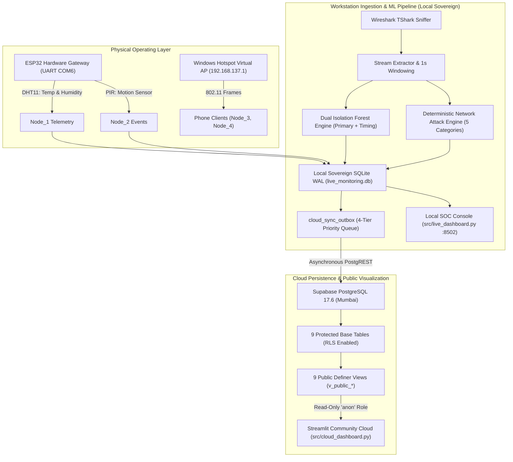

# IoT Network Guard — Dual-Detector SOC Console
**AI-Assisted IoT Wi-Fi Network Security and Anomaly Detection Platform**

[](https://www.python.org/)
[](https://www.postgresql.org/)
[](https://supabase.com/)
[](https://streamlit.io/)
[]()
[](LICENSE)

---

## 1. Project Overview

**IoT Network Guard** is a dual-tier cybersecurity monitoring platform designed to protect smart home and enterprise IoT deployments against wireless network threats. Combining real-time 802.11 Wi-Fi packet inspection, dual Isolation Forest machine learning anomaly detection, deterministic forensic cyberattack classification, and physical ESP32 environmental sensor monitoring, the platform delivers an operational Security Operations Center (SOC) experience both locally and in the cloud.

---

## 2. Problem Statement

Consumer and commercial Internet of Things (IoT) devices present acute cybersecurity challenges:
- **Asymmetric Vulnerability:** Low-cost microcontrollers, IP cameras, and smart sensors often run unpatched firmware, lack transport encryption, and are susceptible to volumetric Denial of Service (DoS), ARP spoofing, reconnaissance sweeps, and deauthentication attacks.
- **Explainability Gap:** Traditional machine learning anomaly detectors generate opaque outlier scores without actionable threat categories or root-cause explanations.
- **Physical Context Blindness:** Purely digital intrusion detection systems lack awareness of the physical operating environment (e.g., ambient temperature surges or physical human presence).
- **Privacy & Cloud Resilience:** Transmitting raw network packet captures to public clouds violates user privacy. Conversely, cloud-only systems fail when local internet connectivity is disrupted.

**IoT Network Guard solves these challenges** through an authoritative local edge architecture that tokenizes private identifiers, provides explainable threat attribution across 5 deterministic cyberattack categories, correlates ambient physical sensor telemetry, and reliably synchronizes sanitized telemetry to the cloud via a durable outbox queue.

---

## 3. System Architecture



---

## 4. Technology Stack

- **Machine Learning & Analytics:** Python 3.11, Scikit-Learn 1.3+ (Dual Isolation Forest), NumPy, Pandas
- **Packet Ingestion & Sniffing:** Wireshark TShark 4.4+, Npcap, Windows Native Wi-Fi API (WlanAPI)
- **Hardware & Microcontroller:** ESP32-WROOM-32, DHT11 Temperature & Humidity, HC-SR501 PIR Motion, PySerial 3.5
- **Local Storage:** SQLite 3 (Write-Ahead Logging mode, foreign keys enabled)
- **Cloud Database:** PostgreSQL 17.6 managed by Supabase Cloud (Region: `ap-south-1` / Mumbai)
- **Visualization:** Streamlit 1.30+, Plotly Graph Objects (Interactive dual-axis time series, dark obsidian SOC theme)
- **Testing & Quality Assurance:** Pytest (439 automated tests, 100% pass rate)

---

## 5. Local Installation

### Prerequisites
- Windows 10/11 Workstation
- Python 3.11 (64-bit) installed and added to `PATH`
- [Wireshark](https://www.wireshark.org/) installed (default path: `C:\Program Files\Wireshark\tshark.exe`)
- (Optional for physical sensors) ESP32 board flashed with firmware connected to `COM6`

### Setup Instructions
```bash
# 1. Clone the repository
git clone https://github.com/meghasara2/IoT-WiFi-Anomaly-Detection.git
cd IoT-WiFi-Anomaly-Detection

# 2. Create and activate a virtual environment
python -m venv .venv
.venv\Scripts\activate

# 3. Install pinned dependencies
pip install -r requirements.txt

# 4. Initialize the local database schema
python src/init_live_database.py
```

---

## 6. Environment Configuration & Dual Credential Paths

Copy the example configuration to create your local `.env`:
```bash
copy .env.example .env
```

The system strictly decouples the **Public Dashboard** credentials from the **Local Collector** database credentials:

### Path A: Public Dashboard (Read-Only PostgREST Definer Views)
- **SUPABASE_URL:** Project endpoint (`https://cwqumhtzeiqrfhlesksw.supabase.co`)
- **SUPABASE_ANON_KEY:** Unprivileged public anonymous key. Used by Streamlit Cloud to query sanitized views (`v_public_*`). Base table access is completely revoked.

### Path B: Local Collector (Dedicated Ingestion via PostgreSQL Pooler)
- **SUPABASE_POOLER_HOST:** `aws-1-ap-south-1.pooler.supabase.com`
- **SUPABASE_POOLER_PORT:** `6543` (Transaction Pooler) or `5432` (Session Pooler)
- **SUPABASE_DB_NAME:** `postgres`
- **SUPABASE_COLLECTOR_USER:** Dedicated user `iot_collector.cwqumhtzeiqrfhlesksw`
- **SUPABASE_COLLECTOR_PASSWORD:** Dedicated PostgreSQL password configured via `ALTER USER iot_collector WITH PASSWORD`
- **SUPABASE_SSLMODE:** `require`

> [!WARNING]
> The dedicated collector password is used **exclusively as a PostgreSQL database password** through the connection pooler. It is never sent as an HTTP API key or Bearer token, and must never be committed to source control or exposed in Streamlit secrets.

---

## 7. Local Dashboard Startup

Launch the local interactive SOC console (runs with zero internet dependencies against `data/live_monitoring.db` in read-only mode):
```bash
streamlit run src/live_dashboard.py --server.port 8502
```
Access the console at `http://localhost:8502`.

---

## 8. Cloud Dashboard Architecture

The public cloud dashboard (`src/cloud_dashboard.py`) is designed for hosting on **Streamlit Community Cloud**:
- **Read-Only Definer Views:** Queries exclusively from `v_public_*` views using the unprivileged `anon` role. Direct base table access is 100% revoked.
- **Hardware-Free Execution:** Requires zero PCAP capture drivers, COM ports, or local SQLite database files.
- **Zero Raw PII:** Station tokens are mapped to allowlisted pseudonyms (`Node_1`..`Node_5`), and target IPs are categorized semantically into `LOCAL_NETWORK`, `EXTERNAL_NETWORK`, and `IP_REDACTED`.

To run the cloud dashboard locally for verification:
```bash
streamlit run src/cloud_dashboard.py --server.port 8503
```

---

## 9. Supabase Setup & Cloud Migration

1. In your Supabase Project (`cwqumhtzeiqrfhlesksw`), navigate to the **SQL Editor**.
2. Open [`scratch/stage3b_6_final_supabase_migration.sql`](scratch/stage3b_6_final_supabase_migration.sql), copy its contents, and click **Run**.
3. Set the production collector password in a private SQL query:
   ```sql
   ALTER USER iot_collector WITH PASSWORD '<your-secure-password>';
   ```
4. Record your public `anon` key from **Project Settings -> API** for use in Streamlit Secrets.

---

## 10. Collector Synchronization & Pooler Transport

The collector incorporates an asynchronous local staging queue (`cloud_sync_outbox`) and background synchronization worker connecting via `psycopg2`:
- **Dedicated PostgreSQL Pooler:** Ingestion routes directly through the Supabase connection pooler (`port 6543`), executing parameterized SQL queries under the unprivileged `iot_collector` role.
- **Foreign-Key Dependency Ordering:** Outbox items are strictly grouped and dispatched in topological dependency order (`collector_status` -> `device_registry` -> `live_traffic_windows` -> `live_alerts` -> `live_attack_events`), guaranteeing parent records are committed before dependents.
- **Idempotency & Immutability:**
  - Mutable state tables (`collector_status`, `device_registry`, `unknown_device_obs`): Handled via `ON CONFLICT (...) DO UPDATE`.
  - Immutable evidence tables (`live_traffic_windows`, `live_alerts`, `live_sensor_telemetry`, `live_pir_events`, `live_attack_events`): Handled via `ON CONFLICT (...) DO NOTHING`.
- **Durable At-Least-Once Delivery:** Failed child inserts (e.g. temporary network drops or pending parent commits) trigger exponential backoff without losing either parent or child records.
- **Zero Edge Blocking:** Live packet capture and dual-detector machine learning operate entirely on local SQLite transactions; network I/O is isolated on a background daemon.

---

## 11. Security and Privacy Model

- **Principle of Least Privilege (PoLP):** `collector_role` has `SELECT` and `INSERT` on all tables, `UPDATE` strictly restricted to 3 mutable tables (`collector_status`, `device_registry`, `unknown_device_obs`), and `DELETE`/`TRUNCATE` permanently revoked.
- **Public Isolation:** The `anon` role has zero base table permissions. It can only query the 9 definer security views (`security_invoker = false`).
- **Crash-Proof Numeric Casting:** All numeric casts in `sanitized_evidence_json` are bounded by strict regex (`^[0-9]{1,9}$` for integers, `^[0-9]{1,8}(\.[0-9]{1,4})?$` for floats), preventing integer overflow exceptions.
- **Cryptographic Tokenization:** `station_pseudonym_map` is protected by Row-Level Security (RLS) and is inaccessible to public callers.

---

## 12. Testing Instructions

Execute the complete automated test suite (458 unit and integration tests):
```bash
# Run all automated tests
python -m pytest tests/

# Run static SQL security validation suite (24 checks)
python scratch/validate_stage3b_6_sql.py

# Run collector authentication and foreign-key dependency suite
python -m pytest tests/test_collector_authentication_and_foreign_keys.py
```

---

## 13. Known Limitations

In the interest of scientific integrity, the following real-world operational limitations are documented:
1. **Windows Hotspot Capture Restrictions:** Windows virtual hotspot interfaces may strip 802.11 management frames (such as Beacon or Probe frames) from standard user-space Npcap capture, redirecting reliance to transport-layer metrics.
2. **Android Randomized MAC Behavior:** Modern mobile operating systems utilize randomized MAC addresses when scanning or connecting to Wi-Fi. Unregistered addresses are flagged for surveillance but must never be automatically blocked without operator review.
3. **Management-Frame Sniffing Limitations:** Dedicated 802.11 deauthentication and disassociation monitoring requires an ESP32 hardware sniffer configured to monitor raw management frames.
4. **Physical Sensor Sampling Latency:** DHT11 temperature and humidity sensors have a 1–2 second physical refresh latency. Physical telemetry provides ambient context and is decoupled from high-rate packet anomaly attribution.
5. **Cloud Synchronization Lag:** Under normal network conditions, cloud telemetry sync latency is 1–3 seconds. During internet disruptions, events buffer locally in SQLite until connection recovery.

---

## 14. Deployment Instructions

To deploy the public console to **Streamlit Community Cloud**:
1. Fork or push the repository to GitHub on branch `main`.
2. Connect to [share.streamlit.io](https://share.streamlit.io) and create a **New app**.
3. Set **Main file path:** `src/cloud_dashboard.py`.
4. In **Advanced settings -> Secrets**, configure:
   ```toml
   [supabase]
   url = "https://cwqumhtzeiqrfhlesksw.supabase.co"
   key = "your-supabase-public-anon-key"
   ```
5. Click **Deploy!**.

---

## 15. Research Team & Acknowledgements

**Department of Networking and Communications**  
School of Computing, College of Engineering and Technology  
SRM Institute of Science and Technology, Kattankulathur, Chennai, India  

- **Student Researcher:** S. Meghana (RA2111027010143)
- **Project Supervisor:** Dr. J. Selva Kumar, M.E., Ph.D.

