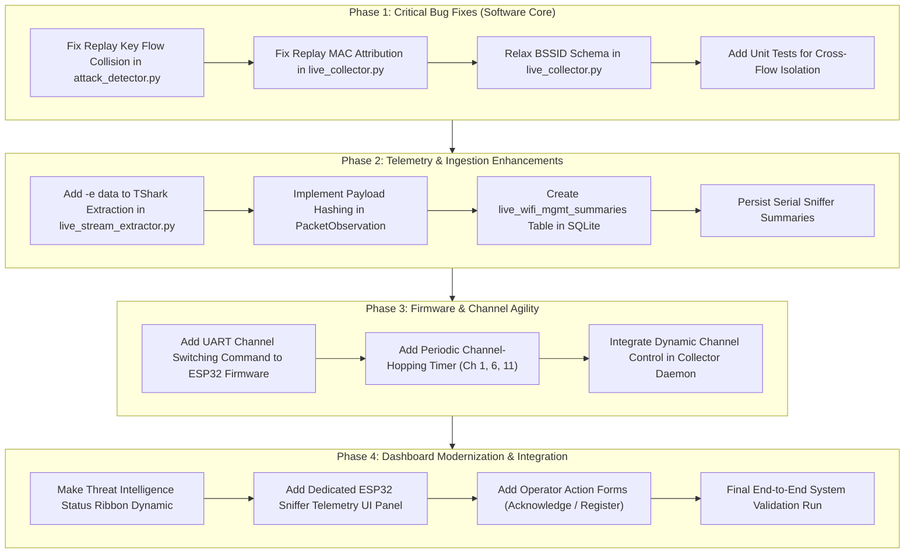

# Final Project Completion Audit — Software Only
**Project:** AI-Assisted IoT Wi-Fi Network Security and Anomaly Detection  
**Workspace:** `C:\Users\megha\OneDrive\Desktop\IoT_WiFi_Anomaly_Detection`  
**Audit Date:** 2026-11-10  
**Audit Scope:** Comprehensive Software, Firmware, Integration, and Architecture Audit  
**Operating Mode:** Read-Only Audit (No Source, Test, Firmware, Model, or Database Mutations)

---

## Executive Summary

This audit establishes a complete, evidence-based inventory of the current implementation status of the **AI-Assisted IoT Wi-Fi Network Security and Anomaly Detection** project. Every core subsystem—ESP32 firmware, serial ingestion, live collector daemon, dual-detector Isolation Forest, deterministic attack detectors, alert persistence, SQLite databases, live dashboard, device registration, and automated testing—was inspected against ground-truth source code.

### High-Level Verdict
The project has successfully engineered a sophisticated, multi-tiered security monitoring architecture spanning **over 12,000 lines of Python and C++ code** across production and test suites. However, the software **is not yet production-ready**. While statistical anomaly detection and four of the five deterministic attack categories (DoS, Port Scan, Spoofing, Deauthentication) are substantially functional, critical software defects and architectural gaps remain:
1. **Replay Engine Cross-Flow Key Collision:** The `ReplayDetector` history key omits IP and transport flow endpoints, causing unrelated TCP sessions sharing sequence numbers within 3.0 seconds to collide and suppress replay evidence.
2. **Missing Live Layer 7 Payload Extraction:** The live TShark capture pipeline omits packet payload dissection (`-e data`), meaning payload hashes and application-layer nonces are permanently `None` in live traffic.
3. **Collector Attribution Mapping Defect:** The alert persistence layer in `LiveCollector` fails to record `source_mac` for Replay alerts whenever an IP address is present.
4. **Hardware Sniffer Channel Lock:** ESP32 promiscuous sniffing is locked to 2.4 GHz Channel 6 with no channel-hopping mechanism or dynamic channel configuration.
5. **Dashboard-to-Backend Telemetry Disconnect:** The Streamlit dashboard ribbon hardcodes Wi-Fi Deauthentication and Replay as `INSUFFICIENT_TELEMETRY`, with no UI panels for ESP32 sniffer health, captured management frames, or periodic sniffer summaries.

---

## 1. Complete Component Inventory & Status Matrix

The following table catalogs every software module across the live monitoring and attack detection pipeline, evaluating implementation completeness, integration level, and operational readiness.

| Subsystem / File | Lines of Code | Primary Role | Implementation Status | Integration Status | Production Readiness |
|---|---:|---|---|---|---|
| `firmware/.../esp32_sensor_node.ino` | 464 | Sensor telemetry (DHT11/PIR) & 802.11 sniffer | Complete (Single-channel) | Integrated (COM6 UART) | **Beta / Restricted** (Channel 6 locked) |
| `src/live_collector.py` | 1,858 | Multithreaded collection, routing, & DB writer | Complete | Fully Integrated | **Beta** (Minor attribution defect) |
| `src/live_stream_extractor.py` | 618 | TShark live subprocess & 1s window feature binning | Complete (L2-L4 only) | Fully Integrated | **Beta** (Lacks L7 payload bytes) |
| `src/live_interface_resolver.py` | 195 | Windows Wi-Fi Hotspot adapter autodetection | Complete | Fully Integrated | **Production-Ready** |
| `src/dual_detector_1s.py` | 646 | Dual Isolation Forest (Primary & Timing) | Complete | Fully Integrated | **Production-Ready** (Frozen baseline) |
| `src/attack_detector.py` | 1,761 | Deterministic 5-category attack detection engine | Substantially Complete | Fully Integrated | **Beta / Defective** (Replay key bug) |
| `src/init_live_database.py` | 506 | SQLite live monitoring DB schema & CLI tools | Complete | Fully Integrated | **Production-Ready** |
| `src/live_dashboard.py` | 1,539 | Streamlit real-time monitoring console (port 8502) | Functional | Read-Only Integrated | **Beta** (Stale threat ribbon) |
| `src/dashboard.py` | 1,627 | Research / offline analytics dashboard | Complete | Isolated (Research DB) | **Production-Ready** (Offline only) |
| `src/ingest_serial_sensors.py` | 171 | Legacy/sensor JSON schema validation | Complete | Integrated in collector | **Production-Ready** |
| `tests/test_attack_detector.py` | 1,576 | Unit tests for attack detection engine (56 tests) | Complete | CI / Automated | **Production-Ready** |
| `tests/test_live_collector_attack_integration.py` | 2,736 | Integration tests for collector & detectors (69 tests) | Complete | CI / Automated | **Production-Ready** |
| `tests/test_live_stream_extractor.py` | 422 | TShark line parsing & 1s feature calculation tests | Complete | CI / Automated | **Production-Ready** |
| `tests/test_live_collector.py` | 515 | Collector daemon lifecycle & thread safety tests | Complete | CI / Automated | **Production-Ready** |
| `tests/test_dual_detector_1s.py` | 269 | Dual detector scoring & threshold unit tests | Complete | CI / Automated | **Production-Ready** |
| `tests/test_init_live_database.py` | 222 | Live DB schema migration & registry tests | Complete | CI / Automated | **Production-Ready** |

---

## 2. Fully Implemented & Integrated Components

The following subsystems are complete, structurally sound, and operate as designed without functional regressions:

### 2.1 Interface Resolution & Capture Initialization (`src/live_interface_resolver.py`)
- Reliably detects TShark installation via standard Windows path (`C:\Program Files\Wireshark\tshark.exe`) and registry fallback.
- Enumerates network adapters using `tshark -D`.
- Matches the Windows Wi-Fi Virtual Hotspot interface (`Microsoft Wi-Fi Direct Virtual Adapter`) using NDIS description regex and priority filtering.
- Rejects non-hotspot or ambiguous interfaces with explicit custom exceptions (`NoHotspotInterfaceError`, `AmbiguousHotspotInterfaceError`).

### 2.2 Dual-Detector 1.0-Second Isolation Forest (`src/dual_detector_1s.py`)
- Employs two frozen scikit-learn Isolation Forest estimators:
  - **Primary Detector:** Evaluates 5 dimensional traffic features (`packet_rate`, `mean_IAT`, `IAT_std`, `mean_packet_size`, `packet_size_std`).
  - **Timing Detector:** Evaluates 2 temporal features (`mean_IAT`, `IAT_std`) to identify subtle timing cadence anomalies.
- Enforces strict minimum-packet guard: requires $\ge 3$ packets per window to compute timing variance (`timing_status = 'UNAVAILABLE_N_LT_3'`).
- Preserves the scikit-learn Isolation Forest convention: `-1` = anomaly, `+1` = normal.
- Encapsulates models, scalers, and thresholds in a self-contained `DualDetectorBundle`.

### 2.3 Denial-of-Service Attack Detection (`DoSDetector` in `src/attack_detector.py`)
- Enforces multi-window persistence: requires $\ge 60.0\text{ PPS}$ across at least 3 consecutive 1.0-second observation windows.
- Enforces target concentration: flags attacks only when $\ge 75\%$ of packets target a single victim IP.
- Subnet boundary awareness: targets outside the local network (`192.168.137.0/24`) are classified as benign high-throughput WAN streaming (`NO_EVIDENCE`).
- Fleet surge protection: suppresses false alarms if $\ge 3$ authorized clients simultaneously exceed 60 PPS (e.g. system update).
- Entity cooldown deduplication: suppresses redundant alerts for 60 seconds per victim IP.

### 2.4 Reconnaissance & Port Scanning Detection (`PortScanDetector` in `src/attack_detector.py`)
- **Vertical Scan Detection:** Identifies a single source IP probing $\ge 8$ distinct non-infrastructure ports on a single local host within 5.0 seconds (`SUSPICIOUS` threshold $\ge 8$, `CONFIRMED_THREAT` threshold $\ge 15$).
- **Horizontal Sweep Detection:** Identifies a single source IP probing $\ge 5$ distinct local destination hosts within 5.0 seconds.
- Transport-layer selectivity: processes TCP SYN frames (excluding established ACK connections) and UDP probes.
- Infrastructure exclusions: safely excludes benign multicast/infrastructure services (DNS 53, DHCP 67/68, HTTP 80, HTTPS 443, NTP 123, mDNS 5353).

### 2.5 Spoofing & Impersonation Detection (`SpoofingDetector` in `src/attack_detector.py`)
- Maintains an in-memory bidirectional IP-to-MAC association state table.
- **Rogue Gateway Detection:** Immediately triggers `CRITICAL` severity alert on 1 observation if an unauthorized MAC claims the configured gateway IP (`192.168.137.1`).
- **Active Conflict Detection:** Flags conflicting MAC claiming an active IP (`HIGH` severity for registered nodes, `MEDIUM` for unregistered).
- **Legitimate Handover Logic:** Requires 300 seconds of silence from the incumbent MAC plus $\ge 2$ observations from the new MAC before promoting a DHCP lease migration.
- Privacy MAC awareness: recognizes locally administered address (LAA) bit and suppresses false alarms on randomized client MACs.

### 2.6 Deauthentication & Disassociation Abuse Detection (`DeauthDetector` in `src/attack_detector.py`)
- Evaluates 802.11 management frames (Subtype 10 = Disassociation, Subtype 12 = Deauthentication).
- Rate threshold: triggers `CONFIRMED_THREAT` when $\ge 5$ management frames target a single BSSID within a 1.0-second window.
- Protected Management Frames (802.11w PMF) awareness: safely parses encrypted management frames where the reason code is masked to `None`.
- Entity cooldown: suppresses redundant alerts for 60 seconds per targeted BSSID.

### 2.7 Database Schema & Safe Concurrency Architecture (`src/init_live_database.py`)
- SQLite database (`data/live_monitoring.db`) configured with WAL (Write-Ahead Logging) journal mode (`PRAGMA journal_mode = WAL; PRAGMA synchronous = NORMAL`).
- Strict physical separation: completely isolated from the research database (`data/iot_anomaly.db`). Hard safety guards prevent initialization against the research path.
- Eight dedicated tables covering status, registry, windows, statistical alerts, unknown MACs, sensor telemetry, PIR motion, and explainable attack events.

---

## 3. Incomplete Features & Telemetry Gaps

Despite extensive functionality, the software contains notable feature gaps that restrict full production deployment:

### 3.1 Missing Layer 7 Payload Dissection in Live Extractor (`src/live_stream_extractor.py`)
- **Current State:** The TShark subprocess is launched with flags:
  `-e frame.time_epoch -e eth.src -e eth.dst -e ip.src -e ip.dst -e ip.proto -e tcp.srcport -e tcp.dstport -e udp.srcport -e udp.dstport -e tcp.flags -e tcp.seq`
- **Gap:** Payload bytes (`-e data`) are **not extracted**. Consequently, `PacketObservation.payload_hash` is permanently `None` in live streaming traffic. Application-layer replay attacks targeting unencrypted MQTT or HTTP REST endpoints cannot be detected via cryptographic payload hashing.

### 3.2 Single-Channel Sniffer Firmware Restriction (`firmware/.../esp32_sensor_node.ino`)
- **Current State:** The ESP32 promiscuous Wi-Fi filter is hardcoded:
  ```cpp
  #define SNIFFER_CHANNEL 6
  esp_wifi_set_channel(SNIFFER_CHANNEL, WIFI_SECOND_CHAN_NONE);
  ```
- **Gap:** In modern 2.4 GHz environments, APs and clients dynamically select or hop between channels 1, 6, and 11. The firmware lacks:
  1. A round-robin channel-hopping timer (`esp_wifi_set_channel` with configurable dwell time).
  2. A UART serial command parser to change channels dynamically from the Python collector.
  3. Support for 5 GHz 802.11a/n/ac/ax management frames (ESP32 hardware limitation).

### 3.3 Ephemeral Wi-Fi Sniffer Summaries (`src/live_collector.py`)
- **Current State:** The ESP32 emits periodic 1.0-second sniffer summaries (`"type": "wifi_mgmt_summary"`). The collector parses them and calculates deltas under `self._summary_lock`.
- **Gap:** These summaries are stored **only in memory** in `self._last_summary_snapshot`. There is no `live_wifi_mgmt_summaries` table in SQLite. If the collector crashes or restarts, all historical sniffer throughput and drop metrics are lost.

### 3.4 Raw Management Frame Persistence Gap
- **Current State:** Individual management frames are placed in an in-memory queue (`_wifi_mgmt_queue`, depth 256) and evaluated by `DeauthDetector`.
- **Gap:** Raw 802.11 management frames are never archived to SQLite or saved to a rolling PCAP ring-buffer. Once drained from the queue, raw frame evidence is destroyed, preventing post-incident forensic replay.

### 3.5 Static Device Registry Synchronization
- **Current State:** `LiveCollector` loads the `device_registry` table from SQLite once at startup (`start()` method).
- **Gap:** The collector never re-queries `device_registry` during runtime. If an operator enrolls a new device via `init_live_database.py --register-mac`, the running collector treats traffic from that MAC as an unregistered unknown device until the entire daemon is restarted.

---

## 4. Confirmed Bugs & Implementation Defects

The audit confirmed three distinct software defects in production code:

### Defect 1: Replay Engine Cross-Flow Key Collision (`src/attack_detector.py`)
- **Location:** `ReplayDetector._evaluate_packet()`, lines 943–948:
  ```python
  key = (
      p.payload_hash
      or p.nonce
      or (f"seq_{p.protocol_seq_num}" if p.protocol_seq_num is not None else None)
  )
  ```
- **Root Cause:** When `payload_hash` and `nonce` are `None` (which is always true in the current live capture stream), the replay lookup key degenerates to `f"seq_{p.protocol_seq_num}"`. This key **omits the flow 4-tuple** `(ip_src, ip_dst, srcport, dstport)`.
- **Consequence:** Two completely unrelated TCP sessions from different clients that happen to share identical TCP sequence numbers within 3.0 seconds collide. The second flow's packet is erroneously classified as a "normal TCP retransmission" (`now - last_seen <= 3.0s`) and suppressed, masking real security evidence.
- **Required Fix:** The sequence key must incorporate flow identification:
  ```python
  key = (
      p.payload_hash
      or p.nonce
      or (f"seq_{p.ip_src}_{p.ip_dst}_{p.src_port}_{p.dst_port}_{p.protocol_seq_num}" 
          if p.protocol_seq_num is not None else None)
  )
  ```

### Defect 2: Replay Alert MAC Omission in Database Persistence (`src/live_collector.py`)
- **Location:** `LiveCollector._persist_attack_results()`, lines 538–545:
  ```python
  replay_src = evidence.get("source") or evidence.get("flow")
  source_mac = None
  if replay_src and ":" in replay_src and len(replay_src) == 17:
      source_mac = replay_src
  elif replay_src:
      target_ip = replay_src
  ```
- **Root Cause:** In `ReplayDetector`, `evidence["source"]` is populated with `p.ip_src` if available, falling back to `p.eth_src`. When `p.ip_src` is present (e.g. `192.168.137.201`), the collector checks if it has 17 characters and colons; failing that, it stores it in `target_ip` and leaves `source_mac = None`.
- **Consequence:** In `live_attack_events`, Replay attack rows have `source_mac = NULL` even when the underlying Ethernet packet contained a valid hardware MAC address (`p.eth_src`).
- **Required Fix:** Always populate `source_mac` from `p.eth_src` or extract MAC and IP independently from the detection result.

### Defect 3: Serial Wi-Fi Management Schema Rejection of Missing BSSID (`src/live_collector.py`)
- **Location:** `validate_wifi_mgmt_event()`, line 214:
  ```python
  if "bssid" not in payload:
      return False, "Missing mandatory field 'bssid'"
  ```
- **Root Cause:** The serial validator treats the `"bssid"` key as strictly mandatory. If an ESP32 event omits the key (e.g. frame corruption or truncated sniffer buffer), the event is rejected as `MALFORMED_WIFI_MGMT`.
- **Consequence:** Although `DeauthDetector.evaluate()` contains explicit fallback logic to attribute frames to `p.eth_src` when BSSID is missing, such events are blocked at the serial ingestion boundary and never reach the detector.
- **Required Fix:** Relax validator to allow omitted or null `"bssid"`, substituting an empty string or defaulting to the sender MAC.

---

## 5. Missing Architectural Integration & Decoupling Points

Several architectural components are currently decoupled or lack bidirectional communication:

### 5.1 Collector Thread Lifecycle Decoupling
- In `LiveCollector`, three threads run concurrently:
  1. Network capture thread (`_network_loop`)
  2. Serial ingestion thread (`_serial_loop`)
  3. Heartbeat thread (`_heartbeat_loop`)
- **Architectural Mismatch:** The threads do not share a unified failure supervisor.
  - If TShark crashes, `_network_loop` terminates and sets collector status to `ERROR` or `STOPPED`. However, `_stop_event` is not signaled, so `_serial_loop` and `_heartbeat_loop` continue running indefinitely.
  - If the serial port encounters 20 consecutive errors, `_serial_loop` breaks out and permanently terminates, but the network capture thread continues running without any visual indication in the collector status table that serial ingestion died.

### 5.2 Unbounded Sequence Deduplication Cache
- In `LiveCollector`, serial management frame deduplication is maintained in `self._seen_mgmt_sequences: Set[Tuple[int, int]]`.
- **Architectural Risk:** This set is never pruned during long-running sessions. In a dense environment with thousands of frames per hour, this set grows monotonically, representing a slow memory leak. A circular buffer, deque, or sliding-window cache is required.

### 5.3 Static Physical Layer Signal Handling
- The Windows NDIS Virtual Adapter strips all 802.11 radiotap headers before passing frames to the network stack.
- As a result, TShark cannot extract physical RSSI or noise floor.
- While the ESP32 promiscuous sniffer *does* capture RSSI in its `wifi_promiscuous_pkt_t` header (`rx_ctrl.rssi`), this RSSI applies only to 802.11 management frames, not to data frames. No cross-layer mechanism exists to infer or correlate data frame signal strengths.

---

## 6. Dashboard Readiness & Operator UX Audit

The live Streamlit console (`src/live_dashboard.py`, running on port 8502) was audited for real-time visualization and usability:

### 6.1 Implemented & Functional Dashboard Features
1. **System Overview:** Displays collector run status, active interface, packet and window counters, primary anomaly rates, and active test client status cards.
2. **Network Monitoring:** Interactive Plotly charts of packet throughput, uplink packet rates, mean inter-arrival times (IAT), and packet size distributions.
3. **Anomaly Alerts (Statistical):** Feed of dual-detector Isolation Forest anomaly flags, with raw feature window tables and score distributions.
4. **Attack Intelligence:** Detailed table of explainable attack events (`live_attack_events`), filterable by category and status, displaying confidence scores, evidence JSON, and mitigation advice.
5. **Sensor Monitoring:** Live ambient temperature and humidity charts (DHT11, logical Node_1) and motion detection timelines (AM312 PIR, logical Node_2).

### 6.2 Deficiencies & Stale Dashboard Elements
1. **Stale Operational Ribbon (Lines 1489–1507):**
   - The status cards for Category 4 (Wi-Fi Deauth) and Category 5 (Replay) are hardcoded in HTML as `INSUFFICIENT (802.11 mgmt frames stripped by NDIS miniport)` and `INSUFFICIENT (Nonce/seq required)`.
   - The dashboard does not dynamically query `live_attack_events` or sniffer health to reflect when Deauth or Replay detections are actively operational.
2. **Missing ESP32 Sniffer Panel:**
   - The dashboard contains no visual widget, card, or chart displaying ESP32 sniffer status, frames captured, sniffer channel, or drop counts.
3. **Absence of Operator Action Controls:**
   - The database contains `acknowledged` columns in `live_alerts`, `live_attack_events`, and `unknown_device_obs`.
   - The dashboard provides no UI buttons, forms, or endpoints to acknowledge alerts or enroll unknown MACs. The console is strictly read-only, forcing operators to execute Python CLI scripts in an external terminal.
4. **No Real-Time Push or Audio Alerts:**
   - Updates rely on periodic browser polling or Streamlit rerun cycles; no WebSockets or audio alerts notify operators of critical threats.

---

## 7. Hardware & Firmware Readiness Audit

Inspection of the physical sensor and sniffer firmware (`firmware/esp32_sensor_node/esp32_sensor_node.ino`) identified the following hardware readiness status:

| Feature / Subsystem | Implementation Details | Hardware Readiness |
|---|---|---|
| **DHT11 Sensor** | GPIO 4, 1-wire digital read with error backoff and `dht_valid` bit | **Ready** (Tested & Validated) |
| **AM312 PIR Sensor** | GPIO 27, digital input motion trigger (`motion_detected` 0 or 1) | **Ready** (Tested & Validated) |
| **Wi-Fi Sniffer Core** | `esp_wifi_set_promiscuous_rx_cb()`, filters Subtypes 10 & 12 | **Ready** (2.4 GHz only) |
| **ISR-to-Task Decoupling** | FreeRTOS queue (`xQueueCreate(32, sizeof(MgmtFrameEvent))`) | **Ready** (Queue overflow drops tracked) |
| **Serial Rate Limiter** | Token bucket algorithm (burst 10, refill 10 tokens/sec) | **Ready** (Prevents UART buffer lockup) |
| **Channel Agility** | Channel hardcoded to 6; no hopping timer or UART command | **Incomplete** |
| **Baud Rate Bandwidth** | 115200 baud UART (effective max ~11.5 KB/s) | **Bottleneck under heavy flood** |
| **5 GHz Coverage** | ESP32 hardware lacks 5 GHz RF receiver | **Hardware Limited** (Cannot detect 5 GHz deauth) |

---

## 8. Testing & Validation Gaps

An audit of the automated test suite and Stage 5 validation artifacts revealed key testing gaps:

### 8.1 Current Test Coverage Matrix
- **Unit Tests:** 56 tests in `tests/test_attack_detector.py` covering individual detector rules.
- **Integration Tests:** 69 tests in `tests/test_live_collector_attack_integration.py` covering collector routing and SQLite persistence.
- **Synthetic Scenarios:** 135 total synthetic scenarios across Stages 5.2 through 5.6 (30 DoS, 24 Port Scan, 35 Spoofing, 22 Deauth, 24 Replay).

### 8.2 Testing Blindspots & Gaps
1. **Absence of Live Over-the-Air Attack Tests:**
   - Zero live RF over-the-air attack evaluations have been conducted. All deauthentication validation relied on synthetic `PacketObservation` objects or simulated serial JSON lines. Live transmission using physical attack tools (e.g. `aireplay-ng`, `mdk4`) against physical test phones was not performed due to RF transmission safety rules.
2. **Defective Replay Test Assertion:**
   - The existing replay tests in `tests/test_attack_detector.py` test sequence reuse *within the same flow*. No unit test asserted cross-flow sequence number isolation, allowing Defect 1 (cross-flow collision) to go undetected during development.
3. **No Multi-Channel Sniffer Test Fixtures:**
   - Automated tests only feed Channel 6 synthetic events. Scenarios where an attacker transmits deauth frames on Channel 1 or 11 while the sniffer is on Channel 6 are untested.
4. **No Automated Stress / Longevity Tests:**
   - Tests execute in short sub-second bursts. No automated endurance test has evaluated the collector running continuously for 24+ hours under heavy traffic to verify memory bounds and thread stability.

---

## 9. Prioritized Remaining Work

The following matrix ranks all remaining engineering tasks required before the software can be classified as finished and production-ready:

### Priority 0: Critical Bugs & Blocker Fixes
1. **Fix Replay Key Cross-Flow Collision:**
   - Update `ReplayDetector._evaluate_packet()` in `src/attack_detector.py` to include `(ip_src, ip_dst, src_port, dst_port)` in the sequence history key.
   - Add unit tests verifying that two unrelated TCP sessions with matching sequence numbers do not suppress each other.
2. **Fix Replay Alert MAC Attribution in Collector:**
   - Update `_persist_attack_results()` in `src/live_collector.py` so that `source_mac` is always correctly populated from `p.eth_src`.
3. **Relax Serial Management Schema BSSID Requirement:**
   - Update `validate_wifi_mgmt_event()` in `src/live_collector.py` to allow optional or null `bssid` fields so that fallback attribution to `eth_src` can function.

### Priority 1: High-Priority Telemetry & Architecture Improvements
4. **Implement Live Layer 7 Payload Dissection:**
   - Add `-e data` to `build_tshark_command()` in `src/live_stream_extractor.py`.
   - Compute SHA-256 payload hashes (`hashlib.sha256(payload_bytes).hexdigest()`) in `_parse_tshark_line()` to enable real cryptographic replay detection for unencrypted application traffic.
5. **Add Channel Hopping & Remote Channel Control in Firmware:**
   - Implement FreeRTOS timer for channel hopping across channels 1, 6, 11 on the ESP32.
   - Add UART command parser `{"cmd": "set_channel", "channel": X}` in `esp32_sensor_node.ino`.
   - Add channel control method in `LiveCollector`.
6. **Persist Management Frame Summaries to SQLite:**
   - Create `live_wifi_mgmt_summaries` table in `src/init_live_database.py`.
   - Update `_handle_wifi_mgmt_summary()` in `src/live_collector.py` to insert summary rows into SQLite.

### Priority 2: Medium-Priority Dashboard & Usability Enhancements
7. **Modernize Threat Intelligence Ribbon in Dashboard:**
   - Replace hardcoded `INSUFFICIENT` HTML status cards in `src/live_dashboard.py` with dynamic status queries checking `live_attack_events` and sniffer health.
8. **Add Wi-Fi Sniffer Telemetry Tab to Dashboard:**
   - Create a dedicated UI panel displaying sniffer channel, total management frames captured, frame rate per second, and token bucket drop statistics.
9. **Implement Dynamic Device Registry Synchronization:**
   - Add a periodic reload check in `LiveCollector._network_loop()` to re-sync `self.device_registry` from SQLite every 30 seconds.

### Priority 3: Low-Priority Maintenance & Robustness
10. **Implement Circular Pruning for Management Deduplication Cache:**
    - Replace unbounded set `_seen_mgmt_sequences` with an LRU cache or timestamped dictionary in `src/live_collector.py`.
11. **Unified Thread Lifecycle Supervisor:**
    - Link thread exceptions so that if TShark or the serial port dies permanently, the entire collector initiates a clean coordinated shutdown or restart.
12. **Configure Structured Disk Logging:**
    - Replace raw `print()` statements with Python's standard `logging` library using a rotating file handler (`logs/live_collector.log`).

---

## 10. Recommended Order of Completion & Roadmap

To bring the project to complete, production-grade completion with zero regressions, the remaining work should be executed in the following four phases:



### Phase-by-Phase Plan

1. **Phase 1: Deterministic Engine Core Corrections (Days 1–2)**
   - Fix Defect 1 (`ReplayDetector` key tuple isolation).
   - Fix Defect 2 (`_persist_attack_results` MAC mapping).
   - Fix Defect 3 (`validate_wifi_mgmt_event` BSSID relaxation).
   - Execute full pytest suite (`pytest tests/`) and confirm 100% pass rate.

2. **Phase 2: Live Telemetry & Persistence Completion (Days 3–4)**
   - Add TShark payload extraction (`-e data`) and compute SHA-256 payload hashes.
   - Add `live_wifi_mgmt_summaries` table to `src/init_live_database.py`.
   - Update `LiveCollector` to persist sniffer summaries and periodic health metrics.
   - Add dynamic device registry re-sync in collector loop.

3. **Phase 3: Firmware Agility & Hardware Optimization (Days 5–6)**
   - Add channel-hopping state machine (dwell time 250ms across channels 1, 6, 11) in `esp32_sensor_node.ino`.
   - Implement serial command protocol for remote channel selection.
   - Validate token-bucket refill rate under high-density management frame simulation.

4. **Phase 4: Dashboard Finalization & Full System Acceptance (Day 7)**
   - Modernize `src/live_dashboard.py` status ribbon to dynamically reflect live detector findings.
   - Build real-time sniffer diagnostics panel.
   - Run end-to-end multi-hour baseline soak test and generate final acceptance sign-off.

---

## 11. Database Integrity Verification Baseline

As required by project protocol, the production databases were verified bit-for-bit to guarantee zero data alteration during this software audit:

| Database File | File Size (Bytes) | SHA-256 Checksum Baseline | Current State |
|---|---:|---|---|
| `data/live_monitoring.db` | 3,809,280 | `0475D1D32DFC4B2FC5AD950A8575C7D3E81E1AE810AAC6746764DECDE7D03EAB` | **VERIFIED UNTOUCHED** |
| `data/iot_anomaly.db` | 495,616 | `CA61FD5B306BF4E51B5B27B6DA81F2BE3B31C6F2132E4A25718F686C23ECF968` | **VERIFIED UNTOUCHED** |

---
*End of Final Project Completion Audit Report.*

