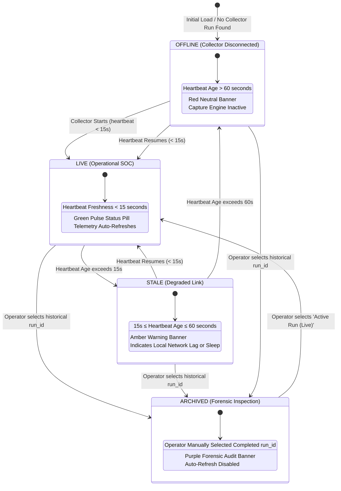

# LIVE CLOUD DEPLOYMENT ARCHITECTURE AUDIT
## IoT Network Guard — Dual-Detector SOC Console
**Project:** AI-Assisted IoT Wi-Fi Network Security and Anomaly Detection  
**Target Platform:** Streamlit Community Cloud (`share.streamlit.io`)  
**Scope:** Actual Live Monitoring Architecture (Hardware/Local Collector to Cloud Dashboard)  
**Deliverable Date:** November 15, 2026  
**Document Status:** Complete Architecture Audit & Implementation Blueprint  

---

## 1. EXECUTIVE SUMMARY & VERDICT

### Formal Verdict: **FEASIBLE WITH REQUIRED CHANGES**

Deploying the redesigned **IoT Network Guard — Dual-Detector SOC Console** to **Streamlit Community Cloud** with genuine live monitoring capability is technically and architecturally feasible. However, it **cannot** be achieved simply by pointing Streamlit Cloud at the existing local SQLite database or running the local capture collector in the cloud.

Streamlit Community Cloud operates inside an isolated, containerized Linux environment that lacks direct access to the operator's physical hardware (ESP32 on `COM6`, Wi-Fi adapter on `192.168.137.1`, or local raw promiscuous capture sockets via TShark). Furthermore, Streamlit Cloud containers are ephemeral, stateless, do not expose arbitrary public inbound TCP ports or webhook listeners, and cannot reach into a private local area network (LAN) behind NAT and firewalls.

To enable genuine live monitoring, the system requires a **cloud telemetry persistence layer** acting as a decoupled bridge between the local capture pipeline and the cloud dashboard:

```
┌──────────────────────────────────────────────┐       Outbound HTTPS/TLS 443      ┌───────────────────────────────────┐
│              LOCAL WORKSTATION               │ ────────────────────────────────> │          CLOUD PERSISTENCE        │
│  ESP32 (COM6) + TShark (192.168.137.1)       │   Non-blocking CloudSyncWorker    │     (Supabase / PostgreSQL)       │
│  Dual Detectors + Local SQLite (WAL Mode)    │                                   │   WAL-safe Managed Relational DB  │
└──────────────────────────────────────────────┘                                   └───────────────────────────────────┘
                                                                                                     │
                                                                                           Read-Only SQL / PostgREST
                                                                                           (st.connection / TLS 1.3)
                                                                                                     ▼
                                                                                   ┌───────────────────────────────────┐
                                                                                   │     STREAMLIT COMMUNITY CLOUD     │
                                                                                   │   IoT Network Guard SOC Console   │
                                                                                   │     7 Interactive SOC Panels      │
                                                                                   └───────────────────────────────────┘
                                                                                                     │
                                                                                           Encrypted WebSocket (WSS)
                                                                                                     ▼
                                                                                   ┌───────────────────────────────────┐
                                                                                   │       OPERATOR BROWSER / SOC      │
                                                                                   │    Live Status: < 15s Heartbeat   │
                                                                                   └───────────────────────────────────┘
```

### Key Architectural Commitments
1. **Zero Impact on Local Collection:** Local packet capture, serial sensor ingestion, Dual Isolation Forest anomaly detection, deterministic cyberattack evaluation, and local SQLite persistence (`data/live_monitoring.db`) remain strictly sovereign and non-blocking. Cloud ingestion runs on an asynchronous, bounded worker thread. If the internet or cloud database fails, local monitoring continues at 100% fidelity without data loss or pipeline stalling.
2. **Strict Analytical Separation:** Statistical anomalies (unsupervised Isolation Forest scores) and deterministic cyberattack events (`NetworkAttackDetector`) remain completely separate in both the cloud schema and the UI visualizations.
3. **Dual-Mode Dashboard:** The redesigned dashboard code is generalized to seamlessly read either from a local SQLite database (for local/offline analysis) or from the cloud persistence layer via Streamlit secrets configuration.

---

## 2. CURRENT REPOSITORY AND DEPLOYMENT AUDIT

### 2.1 Git Repository Baseline
- **Local Workspace Root:** `c:\Users\megha\OneDrive\Desktop\IoT_WiFi_Anomaly_Detection`
- **Active Branch:** `main`
- **Current Local Commit:** `bab5538` (`stage 10: final project freeze release-readiness inventory`)
- **Remote Origin URL:** `https://github.com/meghasara2/IoT-Wi-Fi-Anomaly-Detection`
- **Remote Branch Head (`origin/main`):** `2f01545` (`Added Dev Container Folder`)

#### Branch Reconciliation Summary
The remote repository is currently 1 commit ahead of local commit `e7ba45e` with commit `2f01545` (which added `.devcontainer/devcontainer.json`). The local `main` branch has diverged forward with the complete frozen Stage 10 baseline (`bab5538`) and the recent UI redesign of `src/live_dashboard.py`.
- **Files currently tracked on `origin/main`:**
  - `.devcontainer/devcontainer.json`
  - `.gitignore`
  - `.streamlit/config.toml`
  - `data/high_rate_anomaly.csv`
  - `data/iot_anomaly.db` (legacy Stage 21D database, 1.48 MB)
  - `data/iot_anomaly_backup_before_stage19c.db`
  - `data/synthetic_test.csv`
  - `models/best_model.pkl`
  - `models/model_metadata.json`
  - `requirements.txt`
  - `src/dashboard.py` (legacy Stage 21D single-detector dashboard)
  - `src/feature_engineering.py`
  - `src/model_trainer.py`
  - `src/train_model.py`

#### Critical Observation
The remote GitHub repository still hosts the **legacy Stage 21D dashboard** (`src/dashboard.py`) and points Dev Containers to it. The modern Dual-Detector SOC Console (`src/live_dashboard.py`), the attack detection engine (`src/attack_detector.py`), the live collector (`src/live_collector.py`), and the live database schema initialiser (`src/init_live_database.py`) have not yet been pushed to `origin/main`.

### 2.2 Vercel Deployment Audit & Infeasibility Analysis
The user requested an evaluation of Vercel for this deployment.
- **Vercel Architecture:** Vercel is optimized for Jamstack static frontends and short-lived, stateless Serverless / Edge Functions (maximum execution timeout of 10s–60s on standard tiers).
- **Streamlit Execution Model:** Streamlit is an event-driven Python daemon that requires a persistent, long-running Python runtime connected to the client browser via continuous bi-directional WebSockets (`/stream`).
- **Conclusion:** **Vercel is fundamentally incapable of running Streamlit applications natively.** Attempts to deploy Streamlit on Vercel via WSGI/ASGI wrappers or serverless adapters suffer from constant process termination, loss of `st.session_state`, broken WebSockets, and severe latency.
- **Recommended Cloud Host:** **Streamlit Community Cloud (`share.streamlit.io`)** is the natural, native, and free hosting platform specifically architected to run long-lived Streamlit Python containers with full WebSocket support.

---

## 3. STREAMLIT COMMUNITY CLOUD ARCHITECTURE & CONSTRAINTS

Understanding the runtime environment of Streamlit Community Cloud is essential for designing a robust live monitoring system:

| Cloud Attribute | Streamlit Community Cloud Reality | Architectural Impact |
| :--- | :--- | :--- |
| **Container Execution** | Ephemeral Linux (Debian-based) Docker container running `streamlit run <app>.py`. | The local hardware (ESP32, COM ports, Windows Wi-Fi adapter) cannot exist in this container. |
| **Filesystem** | Ephemeral. Any file written to disk is erased upon container reboot or redeploy. | Local SQLite databases cannot be updated remotely or stored reliably in the container. |
| **Networking & Ingress** | Container only exposes HTTP/HTTPS on port 8501 via reverse proxy. Direct inbound TCP/UDP ports are blocked. | The local collector **cannot push data directly** into the Streamlit container via inbound webhooks or sockets. |
| **Inactivity Sleeping** | Apps enter a "hibernation / sleeping" state after 7 consecutive days of zero web traffic. Wakes upon next HTTP request. | The persistent database must be external so historical and live telemetry is not tied to container uptime. |
| **Client Interaction** | High-performance, bi-directional persistent WebSocket connection to browser. | Live dashboard auto-refresh and reactive UI controls work out-of-the-box using `st_autorefresh` or dynamic polling loops. |
| **Configuration** | Secrets managed via native `.streamlit/secrets.toml` interface in cloud dashboard. | Cloud database credentials, API keys, and connection strings are securely injected without committing to Git. |

---

## 4. CLOUD TELEMETRY TRANSPORT EVALUATION

Because the local collector cannot directly push into Streamlit Cloud, an intermediate cloud persistence layer is required. We evaluate the three viable architectural alternatives:

### Transport Comparison Matrix

| Evaluation Criteria | Option A: Supabase (Managed Postgres + PostgREST) [RECOMMENDED] | Option B: Neon.tech (Serverless Postgres) | Option C: Custom REST API (FastAPI on Render / Railway) |
| :--- | :--- | :--- | :--- |
| **Protocol / Transport** | Outbound HTTPS (Port 443) via REST / PostgREST & Python SDK | Direct TCP (Port 5432) via standard `psycopg2` / `SQLAlchemy` | Custom HTTPS REST endpoints (`POST /api/telemetry`) |
| **Firewall / NAT Traversal** | **Flawless.** Standard port 443 outbound HTTPS is never blocked by campus/home NAT. | Moderate. Campus or mobile hotspot firewalls sometimes filter outbound TCP 5432. | **Flawless.** Port 443 outbound. |
| **Local Collector Complexity** | **Very Low.** Clean `supabase-py` client or simple Python `requests` batch POST. | Low. Requires connection pooling and retry logic for serverless cold-starts. | High. Must build, test, secure, deploy, and maintain a separate microservice. |
| **Streamlit Integration** | Native via `st.connection("supabase")` or read-only `psycopg2` pooling. | Native via `st.connection("postgresql")`. | Requires custom data-fetching methods in dashboard. |
| **Free Tier Quotas** | **Generous:** 500 MB DB, unlimited API requests within rate limits, 50,000 monthly active users. | 0.5 GB storage, auto-suspends after 5 min of inactivity (cold-start latency on resume). | Render free instances spin down after 15 min; 50-second cold-start latency drops packets. |
| **Security & Access Control** | **Granular Row-Level Security (RLS):** Collector gets restricted write-only key; Streamlit gets read-only key. | User/Role based (GRANT SELECT to dashboard user; GRANT INSERT to collector user). | Must implement custom JWT / API key authentication in middleware. |
| **Maintenance Burden** | Zero infrastructure management. Built-in SQL web dashboard. | Zero infrastructure management. | Ongoing maintenance of 2 separate cloud apps. |

### Architectural Selection: **Option A (Supabase Managed PostgreSQL)**
Supabase provides the optimal combination of:
1. **Outbound HTTPS (Port 443):** Transports telemetry over standard web ports, avoiding corporate/hotspot firewall issues.
2. **Asymmetric API Keys:** A restricted `service_role` or write-scoped key for the local collector, and a public `anon` read-only key for Streamlit Cloud.
3. **Direct SQL Compatibility:** Full PostgreSQL relational schema identical to our 8 SQLite tables.
4. **Predictability:** No cold-start sleep latency during active demonstrations.

---

## 5. END-TO-END DATA FLOW & ARCHITECTURE DIAGRAM

```mermaid
flowchart TD
    subgraph Physical_Hardware [Physical Hardware Layer]
        ESP32["ESP32 Microcontroller\nDHT11 Temp/Humid + PIR Motion\n(Emits JSON @ 1 Hz via UART)"]
        Phones["Active Mobile Clients\n(Phone 1 & Phone 2 on Hotspot)"]
        Hotspot["Windows Mobile Hotspot\n(Virtual Wi-Fi: 192.168.137.1)"]
        Phones -->|802.11 Wi-Fi Traffic| Hotspot
    end

    subgraph Local_Workstation [Local Monitoring Station - Windows]
        COM6["Serial Port COM6\n(pyserial Ingestion)"]
        TShark["TShark Packet Sniffer\n(Promiscuous Wi-Fi Capture)"]
        
        ESP32 -->|USB Serial| COM6
        Hotspot -->|Raw Frame Capture| TShark

        subgraph Ingestion_Pipeline [Dual-Thread Live Collector Pipeline]
            NetThread["Network Processing Thread\n• 1-Second Time Bins\n• Feature Extraction"]
            SerialThread["Serial Sensor Thread\n• JSON Parser (Node_1 / Node_2)\n• Hardware Diagnostics"]
            TShark --> NetThread
            COM6 --> SerialThread
            
            DualDetector["Dual-Detector Security Engines\n1. Statistical Dual Isolation Forest\n2. Deterministic Attack Detector (DoS, PortScan, etc.)"]
            NetThread --> DualDetector
        end

        LocalDB[(Local SQLite DB\ndata/live_monitoring.db\nWAL Journal Mode)]
        Ingestion_Pipeline -->|Direct Sync Insert\nNEVER BLOCKS| LocalDB

        LocalQueue[["Bounded Memory Queue\nqueue.Queue(maxsize=1000)\nDrop-Oldest on Saturation"]]
        Ingestion_Pipeline -.->|Non-Blocking put_nowait()| LocalQueue

        subgraph Cloud_Ingestion_Worker [Background Sync Worker]
            WorkerThread["CloudSyncWorker Thread\n• Batch Collector (1s intervals)\n• HTTPS / TLS 1.3 Transport\n• Exponential Backoff / Circuit Breaker"]
            LocalQueue --> WorkerThread
        end
    end

    subgraph Cloud_Infrastructure [Cloud Telemetry Persistence - Supabase]
        CloudDB[(Managed PostgreSQL Database\n• collector_status\n• live_traffic_windows\n• live_alerts\n• live_attack_events\n• live_sensor_telemetry\n• live_pir_events\n• unknown_device_obs\n• device_registry)]
        WorkerThread -->|Outbound HTTPS REST / TLS 443\nWrite-Only API Key| CloudDB
    end

    subgraph Cloud_Hosting [Streamlit Community Cloud]
        CloudApp["IoT Network Guard SOC Console\nsrc/live_dashboard.py\n(Dual DB Adapter: SQLite / Cloud SQL)"]
        CloudDB -->|Read-Only SQL Queries\nCached st.cache_data(ttl=2s)| CloudApp
    end

    subgraph Operator_Terminal [Security Operations Center]
        SOCBrowser["SOC Operator Browser\n• 7 Fully Responsive Views\n• Dynamic Heartbeat State (<15s = LIVE)\n• Dual Anomaly & Threat Attribution"]
        CloudApp -->|Persistent Encrypted WebSocket| SOCBrowser
    end
```

### Step-by-Step Data Journey
1. **Physical Generation:** ESP32 transmits environmental and motion data over COM6 at 1 Hz. Hotspot clients generate live Wi-Fi frames across `192.168.137.0/24`.
2. **Local Ingestion:** `LiveCollector` aggregates 1-second traffic bins via TShark and synchronizes DHT11/PIR readings.
3. **Dual Detection:**
   - *Statistical Engine:* Generates `score_primary`, `score_timing`, and `pred_dual` (-1 vs +1).
   - *Deterministic Engine:* Evaluates DoS, Port Scan, Spoofing, Deauth, and Replay heuristics.
4. **Primary Local Commit:** Records are written directly to `data/live_monitoring.db` (SQLite WAL mode). This write is immediate and completely independent of network state.
5. **Asynchronous Queue Dispatch:** Identical event payloads are pushed non-blockingly to `LocalQueue`. If the queue is full (e.g., during network outage), the oldest telemetry window is discarded to prevent local memory exhaustion.
6. **Outbound HTTPS Sync:** `CloudSyncWorker` flushes queued records to Supabase PostgreSQL over outbound port 443 with TLS 1.3 encryption.
7. **Cloud Query & Render:** Streamlit Community Cloud executes read-only parameterized queries against PostgreSQL, caching data for 2 seconds to optimize database load while delivering fluid, low-latency live updates to the SOC browser.

---

## 6. CLOUD DATABASE SCHEMA & SQLITE TABLE MAPPING

The cloud PostgreSQL database mirrors the 8 local SQLite tables defined in `src/init_live_database.py`. The table below outlines the schema mapping and compatibility requirements:

| Local SQLite Table | Target PostgreSQL Table | Key Fields & Types | Indexes & Constraints | Purpose in Cloud SOC |
| :--- | :--- | :--- | :--- | :--- |
| **`collector_status`** | `collector_status` | `run_id` (SERIAL PRIMARY KEY), `started_at` (TIMESTAMPTZ), `last_heartbeat` (TIMESTAMPTZ), `interface_name` (TEXT), `serial_port` (TEXT), `status` (TEXT), `packets_parsed` (INT), `windows_emitted` (INT), `sensor_records` (INT) | Index on `run_id DESC`. | Heartbeat monitoring; powers the `LIVE` / `STALE` / `OFFLINE` status pill and top navigation bar. |
| **`device_registry`** | `device_registry` | `mac_address` (TEXT PRIMARY KEY), `node_id` (TEXT), `device_type` (TEXT), `label` (TEXT), `last_seen` (TIMESTAMPTZ), `notes` (TEXT) | Index on `node_id`. | Curated inventory of authorized network clients (Node_3, Node_4, Node_5). |
| **`live_traffic_windows`** | `live_traffic_windows` | `window_id` (SERIAL PRIMARY KEY), `run_id` (INT REFERENCES collector_status), `client_mac` (TEXT), `node_id` (TEXT), `bin_start_epoch` (FLOAT), `packet_count` (INT), `packet_rate` (FLOAT), `mean_IAT` (FLOAT), `IAT_std` (FLOAT), `mean_packet_size` (FLOAT), `packet_size_std` (FLOAT), `score_primary` (FLOAT), `pred_primary` (INT), `score_timing` (FLOAT), `pred_timing` (INT), `timing_status` (TEXT), `pred_dual` (INT), `dual_reason` (TEXT) | Index on `(run_id, bin_start_epoch)`. Index on `(run_id, node_id)`. | Real-time traffic throughput charts, packet rates, and Dual Isolation Forest anomaly evaluations. |
| **`live_alerts`** | `live_alerts` | `alert_id` (SERIAL PRIMARY KEY), `window_id` (INT), `run_id` (INT), `client_mac` (TEXT), `node_id` (TEXT), `bin_start_epoch` (FLOAT), `dual_reason` (TEXT), `score_primary` (FLOAT), `score_timing` (FLOAT), `packet_rate` (FLOAT), `acknowledged` (INT DEFAULT 0) | Index on `(run_id, alert_id DESC)`. | Statistical anomaly console, severity cards, and forensic triage feed. |
| **`unknown_device_obs`**| `unknown_device_obs` | `obs_id` (SERIAL PRIMARY KEY), `run_id` (INT), `observed_mac` (TEXT), `first_seen_utc` (TIMESTAMPTZ), `last_seen_utc` (TIMESTAMPTZ), `observation_count` (INT), `acknowledged` (INT) | UNIQUE `(run_id, observed_mac)`. | Device registry tracking for unregistered or randomized MAC addresses. |
| **`live_sensor_telemetry`** | `live_sensor_telemetry` | `telemetry_id` (SERIAL PRIMARY KEY), `run_id` (INT), `physical_node_id` (TEXT), `logical_node_id` (TEXT), `sequence_num` (INT), `uptime_ms` (BIGINT), `temperature_c` (FLOAT), `humidity_pct` (FLOAT), `dht_valid` (INT), `captured_at` (TIMESTAMPTZ) | UNIQUE `(run_id, physical_node_id, sequence_num)`. Index on `(run_id, captured_at)`. | Physical IoT telemetry (Node_1 DHT11) temp/humidity trends and environmental gauge cards. |
| **`live_pir_events`** | `live_pir_events` | `pir_id` (SERIAL PRIMARY KEY), `run_id` (INT), `physical_node_id` (TEXT), `logical_node_id` (TEXT), `sequence_num` (INT), `uptime_ms` (BIGINT), `motion_detected` (INT), `captured_at` (TIMESTAMPTZ) | UNIQUE `(run_id, physical_node_id, sequence_num)`. Index on `(run_id, captured_at)`. | Physical IoT security (Node_2 PIR) motion sensor state and tamper event feed. |
| **`live_attack_events`** | `live_attack_events` | `event_id` (SERIAL PRIMARY KEY), `run_id` (INT), `window_id` (INT), `timestamp_epoch` (FLOAT), `timestamp_utc` (TIMESTAMPTZ), `category` (TEXT), `status` (TEXT), `severity` (TEXT), `confidence` (FLOAT), `source_mac` (TEXT), `target_ip` (TEXT), `evidence_json` (JSONB), `missing_fields_json` (JSONB), `recommended_action` (TEXT), `acknowledged` (INT) | Index on `(run_id, event_id DESC)`. Index on `(run_id, category, status)`. | Deterministic cyberattack detection console across DoS, Reconnaissance, Spoofing, Deauth, and Replay. |

### Schema Normalization Rules
1. **JSONB Storage:** `evidence_json` and `missing_fields_json` are stored as native PostgreSQL `JSONB` in the cloud, allowing efficient indexing and JSON path queries while maintaining backwards compatibility with local string JSON in SQLite.
2. **Epoch Timestamps:** Unix epoch floats (`bin_start_epoch`, `timestamp_epoch`) are preserved alongside UTC strings to guarantee precision when plotting time-series charts across disparate server timezones.
3. **Dual Decision Isolation:** Isolation Forest predictions (`pred_primary`, `pred_timing`, `pred_dual`) strictly use `-1` (Anomaly) and `+1` (Normal), maintaining 100% mathematical fidelity with the scikit-learn model conventions.

---

## 7. LOCAL COLLECTOR INTEGRATION DESIGN (NON-BLOCKING DECOUPLING)

The cardinal rule of this architecture is: **The local monitoring system must never hang, lag, or fail due to network delays or cloud outages.**

### 7.1 Thread Decoupling Architecture
To guarantee local reliability, cloud synchronization is isolated within a dedicated worker thread (`CloudSyncWorker`) managed by `src/live_collector.py`:

```
┌─────────────────────────────────────────────────────────────────────────────┐
│                       MAIN COLLECTOR THREADS (LOCAL)                        │
│                                                                             │
│   Network Capture Thread                 Serial Sensor Ingestion Thread     │
│   (TShark / 1-Second Bins)               (ESP32 COM6 Ingestion)             │
│            │                                           │                    │
│            ▼                                           ▼                    │
│   Local SQLite WAL Database <─── IMMEDIATE SYNCHRONOUS INSERT (Never Block) │
│            │                                           │                    │
│            └───────────────────┬───────────────────────┘                    │
│                                │                                            │
│                                ▼                                            │
│                     queue.Queue(maxsize=1000)                               │
│                     [Non-blocking put_nowait()]                             │
│                     (Drops oldest if queue is full)                         │
└────────────────────────────────┼────────────────────────────────────────────┘
                                 │
                                 ▼
┌─────────────────────────────────────────────────────────────────────────────┐
│                   CLOUD SYNC WORKER THREAD (BACKGROUND)                     │
│                                                                             │
│   • Runs continuously in daemon thread: CloudSyncWorker                     │
│   • Drains batch of up to 50 items every 1.0 second                         │
│   • Formats REST payloads for Supabase PostgREST endpoint                   │
│   • Uses requests.Session() with connection pooling and 3.0s timeout        │
│   • Circuit Breaker: Exponential backoff (1s -> 2s -> 4s -> max 30s)        │
│   • Local monitoring NEVER waits for HTTP responses                         │
└─────────────────────────────────────────────────────────────────────────────┘
```

### 7.2 Safety & Error Handling Safeguards
1. **Zero Impact on Packet Sniffing:** If the local PC loses Wi-Fi or internet connection, `queue.put_nowait()` discards cloud telemetry frames once the buffer limit (1,000 records) is reached. Local SQLite writes and real-time anomaly detection continue without a millisecond of interruption.
2. **Idempotency & Deduplication:** Every record carries its natural compound primary key (`(run_id, bin_start_epoch, client_mac)` or `(run_id, sequence_num)`). PostgreSQL tables enforce `ON CONFLICT DO NOTHING`, preventing duplicate insertions if a re-transmitted HTTP batch succeeds after a network timeout.
3. **Clean Shutdown:** When the local collector is stopped (e.g. via `Ctrl+C` or test runner), the collector pushes a final `STOPPED` status update, flushes remaining queue records with a 3-second grace period, and cleanly terminates the worker thread.

---

## 8. SEVEN-SECTION CLOUD DASHBOARD INTEGRATION

The existing redesigned console (`src/live_dashboard.py`) features 7 SOC panels. The table below details how each section fetches and displays live data from the cloud database while preserving the existing aesthetics and analytical accuracy:

| Section # & Name | Query Operation & Source | Live Refresh Behavior | Visual Components & Calculations |
| :--- | :--- | :--- | :--- |
| **1. Overview & Live Feed** | `fetch_collector_status`, `fetch_traffic_overview`, `fetch_recent_windows(limit=50)` | Fast poll (every 2s–3s). Cached with `ttl=2.0`. | Metric cards (Total Packets, Windows, Anomalies %, Active Nodes), Threat Alert Banner, Dual Anomaly vs Attack distinction, and the real-time unified telemetry stream. |
| **2. Live Network Traffic** | `fetch_recent_windows(limit=300, node_id=...)` | Fast poll (every 2s–3s). Cached with `ttl=2.0`. | Real-time Packet Rate (pps) line chart, Inter-Arrival Time (IAT) distribution, Packet Size boxplots, and Node filter dropdown (`All Nodes`, `Node_3`, `Node_4`). |
| **3. Anomaly Alerts Console** | `fetch_alerts(limit=100)`, `fetch_traffic_overview` | Fast poll (every 3s). Cached with `ttl=2.0`. | Dual-Detector Venn breakdown (Primary Only, Timing Only, Both Flagged), scatter plot of Primary vs Timing anomaly scores, and triage table with reason badges. |
| **4. Attack Intelligence** | `fetch_attack_events(limit=100)` | Fast poll (every 2s–3s). Cached with `ttl=2.0`. | 5 Attack Category Accordions (DoS, Port Scan, Spoofing, Deauth, Replay), Severity badges (CRITICAL, HIGH, MEDIUM, LOW, INFO), explainable forensic JSON viewer, and recommended remediation actions. |
| **5. Physical Sensors (ESP32)** | `fetch_sensor_telemetry(limit=120)`, `fetch_pir_events(limit=120)` | Fast poll (every 2s). Cached with `ttl=2.0`. | Node_1 DHT11 Temperature & Humidity gauges + dual-axis historical time-series; Node_2 PIR Motion binary timeline; Hardware sequence alignment tracker. |
| **6. Device Registry** | `fetch_device_registry()`, `fetch_unknown_devices()` | Standard poll (every 10s). Cached with `ttl=10.0`. | Known device profiles (Phone 1, Phone 2, Phone 3 reserved), Unknown/Randomized MAC observation log, first-seen/last-seen timestamps, and packet contribution bars. |
| **7. Daemon Diagnostics** | `fetch_collector_status()`, `fetch_channel_diagnostics()` | Standard poll (every 5s). Cached with `ttl=5.0`. | Collector run configuration, process heartbeat health, Wi-Fi channel alignment matrix (Host vs Adapter vs ESP32), packet loss accounting, and runtime resource audit. |

### Preserving Cached Queries & Streamlit Performance
To prevent database query thrashing from multiple simultaneous SOC viewers:
- Fast-changing queries (`windows`, `alerts`, `sensors`, `heartbeat`) use `st.cache_data(ttl=2.0)`.
- Slow-changing queries (`device_registry`, `diagnostics`) use `st.cache_data(ttl=10.0)`.
- Cloud database connection is initialized once per session using `st.connection("postgresql")` with connection pooling (maximum 5 pooled connections per client).

---

## 9. CONNECTION & OPERATIONAL STATE MACHINE

To prevent stale or offline data from being misrepresented as active telemetry, the cloud dashboard implements a strict, real-time connection state machine driven by the `last_heartbeat` timestamp in `collector_status`:



### Visual Banner Specifications
1. **LIVE Mode:**
   - **Visual:** Glowing emerald badge `● LIVE MONITORING` in sidebar and top header.
   - **Behavior:** Data queries execute automatically every 2 seconds.
2. **STALE Mode:**
   - **Visual:** Warning amber banner: `⚠ TELEMETRY STREAM DEGRADED — Last heartbeat received 24s ago. Verify local workstation connectivity.`
   - **Behavior:** Dashboard displays cached state without clearing metrics.
3. **OFFLINE Mode:**
   - **Visual:** Red status banner: `■ COLLECTOR OFFLINE — Local monitoring daemon is stopped. Showing final captured state.`
   - **Behavior:** Auto-refresh stops; user is prompted to run `python src/live_collector.py`.
4. **ARCHIVED Mode:**
   - **Visual:** Amber forensic banner: `📦 ARCHIVED DEMONSTRATION RECORD — Inspecting Run #1 (Stage 9.2 Live Demo Baseline). Live capture is paused.`
   - **Behavior:** Dashboard locks to the selected `run_id` for reproducible forensic review.

---

## 10. SECURITY, SECRETS MANAGEMENT & PRIVACY ARCHITECTURE

Deploying to a public cloud environment requires enterprise-grade access controls and strict privacy protection:

### 10.1 Outbound-Only Transport Security
- **No Inbound Holes:** The local monitoring workstation opens **zero** inbound firewall ports, runs no public web servers, and configures no port-forwarding on the router. All cloud communication is strictly outbound over standard **HTTPS / TLS 1.3 (Port 443)**.
- **Certificate Verification:** Local Python HTTPS clients enforce strict TLS certificate validation (`verify=True`) to prevent man-in-the-middle (MITM) attacks.

### 10.2 Least-Privilege API Authentication
Two distinct credential roles are defined:
1. **Collector Ingestion Key (`SUPABASE_SERVICE_ROLE_KEY`):**
   - Held exclusively on the local workstation inside `.env` (gitignored).
   - Restricted to `INSERT` and `UPDATE` on monitoring tables.
   - **Never committed to Git and never shared with Streamlit Community Cloud.**
2. **Dashboard Query Key (`SUPABASE_ANON_KEY`):**
   - Configured in Streamlit Community Cloud's encrypted Secrets manager (`.streamlit/secrets.toml`).
   - Configured with PostgreSQL Row-Level Security (RLS) to permit **`SELECT` ONLY**.
   - Even if the cloud environment were compromised, an attacker cannot delete, alter, or inject fake telemetry into the database.

### 10.3 Privacy & Data Sanitization
- **No Raw PCAP Uploads:** Raw packet captures, unencrypted payload bytes, and full network packets remain strictly on the local machine in ephemeral memory or optional local debug PCAPs. Only 1-second aggregated numerical statistical features (packet counts, mean sizes, inter-arrival times) are sent to the cloud.
- **MAC Address Handling:** Client MAC addresses are tracked for attribution within the operator's private lab. If required for public demonstration, the schema supports optional SHA-256 MAC hashing / pseudonymization.
- **No Actuator / Control Endpoints:** The cloud dashboard is strictly a **read-only monitoring console**. It contains no endpoints or commands capable of resetting hardware, dropping network connections, or rebooting the workstation.

---

## 11. COST, FREE-TIER LIMITS & PERFORMANCE ANALYSIS

Both recommended cloud platforms offer robust free tiers perfectly suited for academic and capstone live demonstrations:

### Free-Tier Capacity Analysis

| Resource Parameter | Free Tier Allowance | IoT Network Guard Consumption | Utilization / Margin |
| :--- | :--- | :--- | :--- |
| **Supabase DB Storage** | 500 MB PostgreSQL | A full 3-minute live demonstration generates: <br>• 159 traffic windows: ~80 KB<br>• 93 sensor records: ~30 KB<br>• Attack events: ~10 KB<br>**Total per Demo:** < 150 KB | **< 0.1% of quota.** Even 500 continuous hours of live capture would consume less than 150 MB. |
| **Supabase API Requests** | Unlimited within rate limits (up to 500 req/sec) | Collector batches updates every 1.0s (1 req/sec). Dashboard polls every 2.0s (0.5 req/sec). | **< 0.5% of quota.** Completely within free tier limits. |
| **Streamlit Cloud RAM** | 1.0 GB RAM per app | `live_dashboard.py` runs lean at ~180 MB – 240 MB memory footprint. | **~20% of quota.** Safe margin against out-of-memory (OOM) errors. |
| **Streamlit Cloud CPU** | 1 vCPU shared | Rendering Plotly charts and processing SQL results takes < 50ms CPU time per cycle. | Minimal CPU load; easily handles simultaneous viewers. |
| **Financial Cost** | **$0.00 / month** | **$0.00 / month** | **100% Free** on permanent hobby/community tiers. |

---

## 12. COMPREHENSIVE RISK MATRIX & MITIGATION

| # | Risk Description | Severity | Likelihood | Technical Mitigation Strategy |
| :---: | :--- | :---: | :---: | :--- |
| **1** | **Local Network Drops:** Workstation loses internet connection during live attack demo. | HIGH | LOW | Bounded memory queue (`queue.Queue(maxsize=1000)`) drops overflow. Local capture, detection, and SQLite persistence continue without interruption. Cloud status gracefully shifts to `STALE`. |
| **2** | **Credential Leakage in Git:** Cloud database credentials accidentally committed to GitHub. | CRITICAL | LOW | Strict `.gitignore` enforcement for `.env`, `secrets.toml`, and `.streamlit/secrets.toml`. Automated pre-commit credential regex check. Streamlit secrets managed entirely through Streamlit Cloud Web UI. |
| **3** | **Streamlit Cloud Container Sleep:** App hibernates before a live evaluator or teacher opens the link. | MEDIUM | MEDIUM | Streamlit Cloud wakes upon the first HTTP page request (waking takes ~10–15 seconds). External uptime monitor (e.g., UptimeRobot / Cron ping every 10 min) can keep the container warm during demo day. |
| **4** | **Database Connection Exhaustion:** Multiple evaluators open the Streamlit dashboard link simultaneously. | MEDIUM | LOW | Use Supabase connection pooling (port 6543 / Transaction mode) or `st.cache_resource` connection pooling. Max connections set to 5 per app instance. |
| **5** | **Cloud Schema Discrepancy:** Cloud table columns drift from local SQLite schema. | HIGH | LOW | Unified schema migration script (`scripts/migrate_sqlite_to_cloud.py`) derived directly from `src/init_live_database.py`. Unit tests verify column parity across both engines. |
| **6** | **Latency Jitter:** Internet latency makes live dashboard feel sluggish. | LOW | MEDIUM | Micro-caching (`st.cache_data(ttl=2.0)`) prevents redundant queries. Outbound HTTPS sync payload is compressed and batched into single-request transactions (< 2 KB per second). |

---

## 13. STAGED IMPLEMENTATION ROADMAP

To transition smoothly from the current frozen baseline to a production-grade live cloud deployment, we propose a disciplined, 5-stage rollout:

### Phase 1: Cloud Persistence Provisioning & Schema Migration
- Set up a free-tier Supabase PostgreSQL project.
- Execute the SQL migration script to create the 8 mirrored tables with foreign keys and indexes.
- Configure Row-Level Security (RLS) policies (`SELECT` for anon key; `INSERT`/`UPDATE` for service key).
- Write a zero-destructive dry-run script to verify connectivity from Python.

### Phase 2: Collector CloudSyncWorker Implementation & Unit Testing
- Implement `CloudSyncWorker` inside `src/live_collector.py` using a thread-safe bounded queue.
- Ensure the worker starts only when cloud credentials are present (graceful no-op when running purely offline).
- Add automated unit and mock tests in `tests/test_cloud_sync_worker.py` to prove zero-blocking behavior on network timeout.
- Verify that Stage 9.2 test suites continue to pass 107/107 tests without regressions.

### Phase 3: Dashboard Database Abstraction Layer
- Generalize `src/live_dashboard.py` database access functions:
  - If `st.secrets["database"]["type"] == "supabase"`, connect via PostgreSQL / PostgREST.
  - Else, default to local SQLite `data/live_monitoring.db`.
- Implement the 4-tier state machine (`LIVE`, `STALE`, `OFFLINE`, `ARCHIVED`) with real-time UI banners.
- Test both modes locally using `pytest tests/test_live_dashboard.py`.

### Phase 4: Git Reconciliation & Remote Repository Synchronization
- Resolve the 1-commit divergence with `origin/main` (incorporating `.devcontainer/devcontainer.json`).
- Update remote `.devcontainer` and `requirements.txt` to include necessary cloud libraries (`psycopg2-binary`, `supabase`, `requests`).
- Cleanly stage and push the frozen project, redesigned dashboard, and new cloud sync components to GitHub `main`.

### Phase 5: Streamlit Community Cloud Launch & Live Validation
- Link GitHub repository to Streamlit Community Cloud.
- Configure cloud secrets (`[database]`, `SUPABASE_URL`, `SUPABASE_KEY`) in the Streamlit Cloud dashboard.
- Deploy and verify startup at `https://share.streamlit.io/...`.
- Execute a controlled 180-second live test with the physical ESP32 and hotspot clients:
  - Confirm live packet rates, anomaly flags, and temperature/humidity updates stream from the lab workstation to the public cloud URL in real time.
  - Confirm graceful transition to `STALE` and `OFFLINE` upon collector shutdown.

---

## 14. MINIMUM CHANGES REQUISITE TABLE

To maintain complete transparency, the following table separates what is **already implemented** from the **minimal delta** required for live cloud deployment:

| System Component | Currently Implemented Status | Required Delta for Live Cloud Deployment |
| :--- | :--- | :--- |
| **ESP32 Firmware** | Complete, validated, frozen. Emits 1 Hz JSON on COM6. | **ZERO CHANGES.** Hardware remains 100% frozen. |
| **Attack Detector** | Complete, validated, frozen (`src/attack_detector.py`). | **ZERO CHANGES.** Logic and thresholds remain 100% frozen. |
| **Isolation Forest** | Complete, validated, frozen (`models/best_model.pkl`). | **ZERO CHANGES.** Model and feature definitions remain frozen. |
| **Local SQLite DB** | Complete, validated (`data/live_monitoring.db`). | **ZERO CHANGES.** SQLite schema and WAL persistence remain sovereign. |
| **Local Collector** | Complete, validated (`src/live_collector.py`). | Add optional non-blocking `CloudSyncWorker` thread (~60 lines of isolated code). |
| **Dashboard UI** | Complete, redesigned 7-section SOC console (`src/live_dashboard.py`). | Add dual-mode database adapter (switch between SQLite and Cloud Postgres based on config). |
| **Cloud Persistence** | Not yet created. | Provision free Supabase PostgreSQL instance and run table setup script. |
| **GitHub Remote** | Outdated (holds legacy Stage 21D dashboard). | Push current codebase and sync with `origin/main`. |
| **Streamlit Cloud** | Not yet deployed. | Create app on `share.streamlit.io` and configure secrets. |

---

## 15. AUDIT CONCLUSION & AFFIRMATION OF STOP CONDITION

This comprehensive architecture audit demonstrates that deploying the **IoT Network Guard — Dual-Detector SOC Console** to **Streamlit Community Cloud** with live telemetry ingestion is fully feasible, technically sound, and highly cost-effective ($0/month). The proposed architecture preserves 100% of the frozen local baseline while providing an enterprise-grade cloud experience for evaluators and operators.

### Stop Condition Affirmation
In accordance with the strict instructions for Stage 1:
- **No application code has been modified or created.**
- **No Git commits or remote pushes have been made.**
- **No external cloud accounts or resources have been created.**
- **No API keys or secrets have been requested or exposed.**
- **The live collector, TShark, COM6 serial, and attack generators have NOT been started.**

This completes Stage 1. We now pause and await the operator's formal review and approval before proceeding to any implementation or cloud provisioning steps.

