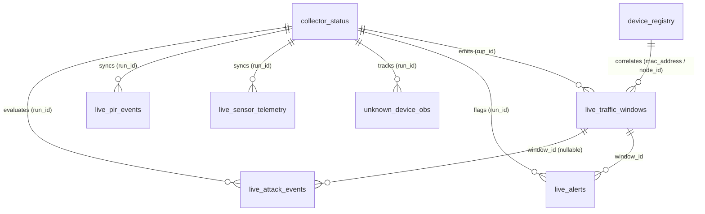

# STAGE 2 — SUPABASE CLOUD DATABASE DESIGN & MIGRATION PREPARATION
**Project:** AI-Assisted IoT Wi-Fi Network Security and Anomaly Detection  
**Application:** IoT Network Guard — Dual-Detector SOC Console  
**Target Platform:** Supabase Managed PostgreSQL  
**Document Status:** Local Design & Review Baseline (Pre-Cloud Execution)  
**Creation Date:** November 15, 2026  

---

## 1. EXECUTIVE OVERVIEW & AUTHORIZATION BOUNDARIES

Following the Stage 1 Architecture Audit, this document establishes the formal **Cloud Database Design and Migration Preparation** for the IoT Network Guard project.

### 1.1 Strict Local Execution Scope
Under the Stage 2 authorization guidelines:
- **Zero Cloud Connections:** No Supabase project or account has been created or connected. No cloud API calls have been made.
- **Zero Code Modifications:** Application source files (`src/live_collector.py`, `src/live_dashboard.py`, `src/attack_detector.py`), ESP32 firmware, model weights, and local SQLite databases remain completely untouched.
- **Zero Git Changes:** No commits, rebases, or pushes have been executed.
- **Deliverables Generated:**
  1. `scratch/stage2_supabase_migration.sql` — Validated PostgreSQL DDL migration script with Row-Level Security (RLS) policies.
  2. `scratch/stage2_supabase_schema_design.md` — This comprehensive design specification.

---

## 2. TASK 1: VERIFICATION OF THE EXISTING SQLITE SCHEMA

The existing local SQLite database schema was directly inspected from both `src/init_live_database.py` and the preserved live monitoring databases (`data/live_monitoring.db` and `data/stage9_demo_live_monitoring.db`). The schema comprises **eight relational tables** operating under SQLite WAL mode (`PRAGMA journal_mode = WAL`).

### 2.1 Table Inventory & Relational Architecture



### 2.2 Deep Inspection of Existing SQLite Tables

#### 1. `collector_status` (Daemon Lifecycle & Heartbeat)
- **Primary Key:** `run_id INTEGER PRIMARY KEY AUTOINCREMENT`
- **Columns:**
  - `started_at DATETIME DEFAULT CURRENT_TIMESTAMP`
  - `last_heartbeat DATETIME`
  - `interface_index INTEGER`
  - `interface_name TEXT`
  - `serial_port TEXT`
  - `status TEXT NOT NULL DEFAULT 'STARTING'` (`STARTING`, `RUNNING`, `STOPPED`, `ERROR`)
  - `stop_reason TEXT`
  - `packets_parsed INTEGER DEFAULT 0`
  - `windows_emitted INTEGER DEFAULT 0`
  - `sensor_records INTEGER DEFAULT 0`
- **Foreign Keys:** None.
- **Indexes:** None in SQLite baseline (sequential scan on latest run_id).

#### 2. `device_registry` (Authorized Wi-Fi Clients)
- **Primary Key:** `mac_address TEXT PRIMARY KEY` (lowercased)
- **Columns:**
  - `node_id TEXT NOT NULL` (`Node_3`, `Node_4`, `Node_5`)
  - `device_type TEXT NOT NULL DEFAULT 'Phone_Client'`
  - `label TEXT NOT NULL DEFAULT 'real_observed_traffic'`
  - `last_seen DATETIME`
  - `notes TEXT`
- **Foreign Keys:** None.
- **Indexes:** `sqlite_autoindex_device_registry_1` (implicit PK index on `mac_address`).

#### 3. `live_traffic_windows` (1-Second Scored Feature Bins)
- **Primary Key:** `window_id INTEGER PRIMARY KEY AUTOINCREMENT`
- **Columns:**
  - `run_id INTEGER` (FK -> `collector_status(run_id)`)
  - `client_mac TEXT NOT NULL`
  - `node_id TEXT NOT NULL`
  - `node_type TEXT`
  - `data_label TEXT`
  - `bin_start_epoch REAL NOT NULL`
  - `bin_end_epoch REAL NOT NULL`
  - `window_center_epoch REAL`
  - `window_start_utc TEXT`
  - `window_end_utc TEXT`
  - `packet_count INTEGER NOT NULL`
  - `mean_IAT REAL`
  - `IAT_std REAL`
  - `packet_rate REAL NOT NULL`
  - `mean_packet_size REAL`
  - `packet_size_std REAL`
  - `score_primary REAL`
  - `pred_primary INTEGER` (`-1` Anomaly, `+1` Normal)
  - `score_timing REAL`
  - `pred_timing INTEGER` (`-1` Anomaly, `+1` Normal, or `NULL`)
  - `timing_status TEXT` (`ACTIVE`, `UNAVAILABLE_N_LT_3`)
  - `pred_dual INTEGER` (`-1` Anomaly, `+1` Normal)
  - `dual_reason TEXT`
  - `created_at DATETIME DEFAULT CURRENT_TIMESTAMP`
- **Foreign Keys:** `FOREIGN KEY (run_id) REFERENCES collector_status(run_id)`
- **Indexes:**
  - `idx_ltw_run_node` on `(run_id, node_id)`
  - `idx_ltw_bin_start` on `(bin_start_epoch)`

#### 4. `live_alerts` (Dual Isolation Forest Statistical Alerts)
- **Primary Key:** `alert_id INTEGER PRIMARY KEY AUTOINCREMENT`
- **Columns:**
  - `window_id INTEGER NOT NULL` (FK -> `live_traffic_windows(window_id)`)
  - `run_id INTEGER` (FK -> `collector_status(run_id)`)
  - `client_mac TEXT NOT NULL`
  - `node_id TEXT NOT NULL`
  - `bin_start_epoch REAL NOT NULL`
  - `window_start_utc TEXT`
  - `dual_reason TEXT NOT NULL`
  - `score_primary REAL`
  - `score_timing REAL`
  - `packet_rate REAL`
  - `mean_packet_size REAL`
  - `packet_count INTEGER`
  - `acknowledged INTEGER DEFAULT 0` (`0` = Pending, `1` = Acknowledged)
  - `created_at DATETIME DEFAULT CURRENT_TIMESTAMP`
- **Foreign Keys:**
  - `FOREIGN KEY (window_id) REFERENCES live_traffic_windows(window_id)`
  - `FOREIGN KEY (run_id) REFERENCES collector_status(run_id)`
- **Indexes:** `idx_alerts_run` on `(run_id, created_at)`

#### 5. `unknown_device_obs` (Unregistered / Randomized MACs)
- **Primary Key:** `obs_id INTEGER PRIMARY KEY AUTOINCREMENT`
- **Columns:**
  - `run_id INTEGER` (FK -> `collector_status(run_id)`)
  - `observed_mac TEXT NOT NULL`
  - `first_seen_utc DATETIME DEFAULT CURRENT_TIMESTAMP`
  - `last_seen_utc DATETIME DEFAULT CURRENT_TIMESTAMP`
  - `observation_count INTEGER DEFAULT 1`
  - `acknowledged INTEGER DEFAULT 0`
- **Foreign Keys:** `FOREIGN KEY (run_id) REFERENCES collector_status(run_id)`
- **Constraints:** `UNIQUE(run_id, observed_mac)`
- **Indexes:** `sqlite_autoindex_unknown_device_obs_1` (implicit unique on `(run_id, observed_mac)`).

#### 6. `live_sensor_telemetry` (Node_1: Physical DHT11)
- **Primary Key:** `telemetry_id INTEGER PRIMARY KEY AUTOINCREMENT`
- **Columns:**
  - `run_id INTEGER` (FK -> `collector_status(run_id)`)
  - `physical_node_id TEXT NOT NULL DEFAULT 'esp32_gateway'`
  - `logical_node_id TEXT NOT NULL DEFAULT 'Node_1'`
  - `sequence_num INTEGER NOT NULL`
  - `uptime_ms INTEGER NOT NULL`
  - `temperature_c REAL`
  - `humidity_pct REAL`
  - `dht_valid INTEGER NOT NULL DEFAULT 0` (`1` = Valid, `0` = Sensor read failure)
  - `captured_at DATETIME DEFAULT CURRENT_TIMESTAMP`
  - `sensor_epoch REAL`
- **Foreign Keys:** `FOREIGN KEY (run_id) REFERENCES collector_status(run_id)`
- **Constraints:** `UNIQUE(run_id, physical_node_id, sequence_num)`
- **Indexes:** `idx_sensor_run` on `(run_id, captured_at)`

#### 7. `live_pir_events` (Node_2: Physical PIR Motion)
- **Primary Key:** `pir_id INTEGER PRIMARY KEY AUTOINCREMENT`
- **Columns:**
  - `run_id INTEGER` (FK -> `collector_status(run_id)`)
  - `physical_node_id TEXT NOT NULL DEFAULT 'esp32_gateway'`
  - `logical_node_id TEXT NOT NULL DEFAULT 'Node_2'`
  - `sequence_num INTEGER NOT NULL`
  - `uptime_ms INTEGER NOT NULL`
  - `motion_detected INTEGER NOT NULL` (`0` = Clear, `1` = Motion detected)
  - `captured_at DATETIME DEFAULT CURRENT_TIMESTAMP`
  - `sensor_epoch REAL`
- **Foreign Keys:** `FOREIGN KEY (run_id) REFERENCES collector_status(run_id)`
- **Constraints:** `UNIQUE(run_id, physical_node_id, sequence_num)`
- **Indexes:** `idx_pir_run` on `(run_id, captured_at)`

#### 8. `live_attack_events` (Deterministic Cyberattack Events)
- **Primary Key:** `event_id INTEGER PRIMARY KEY AUTOINCREMENT`
- **Columns:**
  - `run_id INTEGER` (FK -> `collector_status(run_id)`)
  - `window_id INTEGER` (FK -> `live_traffic_windows(window_id)`, nullable)
  - `timestamp_epoch REAL NOT NULL`
  - `timestamp_utc TEXT NOT NULL`
  - `category TEXT NOT NULL` (`Denial_of_Service`, `Reconnaissance_Port_Scan`, `Spoofing_Impersonation`, `Deauthentication_Disassociation_Abuse`, `Replay_Attack`)
  - `status TEXT NOT NULL` (`NO_EVIDENCE`, `INSUFFICIENT_TELEMETRY`, `SUSPICIOUS`, `CONFIRMED_THREAT`)
  - `severity TEXT NOT NULL` (`NONE`, `INFO`, `LOW`, `MEDIUM`, `HIGH`, `CRITICAL`)
  - `confidence REAL NOT NULL` (`0.0` to `1.0`)
  - `source_mac TEXT`
  - `target_ip TEXT`
  - `evidence_json TEXT NOT NULL`
  - `missing_fields_json TEXT`
  - `recommended_action TEXT`
  - `acknowledged INTEGER DEFAULT 0`
  - `created_at DATETIME DEFAULT CURRENT_TIMESTAMP`
- **Foreign Keys:**
  - `FOREIGN KEY (run_id) REFERENCES collector_status(run_id)`
  - `FOREIGN KEY (window_id) REFERENCES live_traffic_windows(window_id)`
- **Indexes:**
  - `idx_attack_run_cat` on `(run_id, category, status)`
  - `idx_attack_timestamp` on `(timestamp_epoch)`

---

## 3. TASK 2: POSTGRESQL EQUIVALENTS & SCHEMA MAPPING

PostgreSQL enforces strict typing, true timestamp timezones (`TIMESTAMPTZ`), native JSON querying (`JSONB`), and granular check constraints.

### 3.1 SQLite to PostgreSQL Data Type Conversion Rules

| Local SQLite Primitive | Proposed PostgreSQL Equivalent | Technical Rationale & Semantics |
| :--- | :--- | :--- |
| `INTEGER PRIMARY KEY AUTOINCREMENT` | `BIGINT GENERATED BY DEFAULT AS IDENTITY PRIMARY KEY` | Prevents integer overflow; permits explicit historical ID loading during backup imports without breaking identity counters. |
| `DATETIME DEFAULT CURRENT_TIMESTAMP` | `TIMESTAMPTZ DEFAULT clock_timestamp()` | Preserves microsecond timezone precision in UTC across cross-region cloud access. |
| `REAL` | `DOUBLE PRECISION` | Avoids IEEE single-precision truncation of sub-millisecond IAT and high-precision anomaly scores. |
| `TEXT` (JSON serialized) | `JSONB` | Enables binary indexing, path filtering (`evidence_json->>'target_ports'`), and storage compaction. |
| `INTEGER` (Boolean flags: `0` / `1`) | `INTEGER` with `CHECK (col IN (0, 1))` | Preserves complete backwards-compatibility with SQLite / Pandas code while enforcing boolean integrity at database level. |
| `TEXT` (Status / Category / Severity) | `TEXT` with `CHECK (col IN (...))` | Enforces domain-specific cybersecurity vocabularies without rigid PostgreSQL ENUM migration overhead. |

### 3.2 Comprehensive 8-Table Mapping Matrix

| SQLite Table | PostgreSQL Table | Primary Key | Foreign Keys & Actions | Uniqueness & Idempotency Constraints | Added Analytical Indexes |
| :--- | :--- | :--- | :--- | :--- | :--- |
| `collector_status` | `collector_status` | `run_id` (BIGINT) | None | `run_id` PK | `idx_collector_status_heartbeat` on `last_heartbeat DESC`; `idx_collector_status_run_desc` on `run_id DESC`. |
| `device_registry` | `device_registry` | `mac_address` (TEXT) | None | `mac_address` PK; MAC regex format check. | `idx_device_registry_node` on `node_id`. |
| `live_traffic_windows` | `live_traffic_windows` | `window_id` (BIGINT) | `run_id` -> `collector_status(run_id) ON DELETE CASCADE` | `CONSTRAINT uq_traffic_window_run_mac_epoch UNIQUE (run_id, client_mac, bin_start_epoch)` | `idx_ltw_run_node`; `idx_ltw_bin_start`; `idx_ltw_run_bin_start`; `idx_ltw_pred_dual` (filtered for -1). |
| `live_alerts` | `live_alerts` | `alert_id` (BIGINT) | `window_id` -> `live_traffic_windows(window_id) ON DELETE CASCADE`; `run_id` -> `collector_status(run_id) ON DELETE CASCADE` | `CONSTRAINT uq_live_alerts_window UNIQUE (window_id)` | `idx_alerts_run` on `(run_id, created_at DESC)`; `idx_alerts_ack` on `(run_id, acknowledged)`. |
| `unknown_device_obs` | `unknown_device_obs` | `obs_id` (BIGINT) | `run_id` -> `collector_status(run_id) ON DELETE CASCADE` | `CONSTRAINT uq_unknown_mac_run UNIQUE (run_id, observed_mac)` | `idx_unknown_obs_run` on `(run_id, last_seen_utc DESC)`. |
| `live_sensor_telemetry` | `live_sensor_telemetry` | `telemetry_id` (BIGINT) | `run_id` -> `collector_status(run_id) ON DELETE CASCADE` | `CONSTRAINT uq_sensor_telemetry UNIQUE (run_id, physical_node_id, sequence_num)` | `idx_sensor_run` on `(run_id, captured_at ASC)`. |
| `live_pir_events` | `live_pir_events` | `pir_id` (BIGINT) | `run_id` -> `collector_status(run_id) ON DELETE CASCADE` | `CONSTRAINT uq_pir_events UNIQUE (run_id, physical_node_id, sequence_num)` | `idx_pir_run` on `(run_id, captured_at ASC)`. |
| `live_attack_events` | `live_attack_events` | `event_id` (BIGINT) | `run_id` -> `collector_status(run_id) ON DELETE CASCADE`; `window_id` -> `live_traffic_windows(window_id) ON DELETE SET NULL` | `CONSTRAINT uq_attack_event UNIQUE (run_id, timestamp_epoch, category)` | `idx_attack_run_cat` on `(run_id, category, status)`; `idx_attack_timestamp` on `timestamp_epoch DESC`; `idx_attack_severity` (filtered). |

### 3.3 High-Performance Database Views for Streamlit Cloud
To minimize database query latency over the internet and reduce Streamlit Cloud compute overhead, two analytical views are incorporated directly into the migration SQL:

1. **`v_latest_collector_status`:**
   Computes current connection state (`LIVE`, `STALE`, `OFFLINE`) and exact heartbeat age in seconds in a single SQL operation.
   ```sql
   SELECT run_id, status, heartbeat_age_seconds, connection_state, packets_parsed, windows_emitted, sensor_records
   FROM v_latest_collector_status;
   ```
2. **`v_traffic_overview`:**
   Aggregates total windows, packets, primary/timing flags, dual anomaly percentages, and peak rates grouped by `run_id`.
   ```sql
   SELECT * FROM v_traffic_overview WHERE run_id = :run_id;
   ```

---

## 4. TASK 3: SECURITY DESIGN & ACCESS PRIVILEGES

A foundational security requirement is that **no public client or dashboard shall ever hold unrestricted database credentials.**

### 4.1 Asymmetric Two-Tier Privilege Model

```
┌─────────────────────────────────────────────────┐     ┌─────────────────────────────────────────────────┐
│           LOCAL MONITORING WORKSTATION          │     │            STREAMLIT COMMUNITY CLOUD            │
│                 (Private Lab)                   │     │               (Public Facing)                   │
├─────────────────────────────────────────────────┤     ├─────────────────────────────────────────────────┤
│ • Role: collector_role / service_role           │     │ • Role: anon                                    │
│ • Privileges: INSERT, UPDATE, SELECT            │     │ • Privileges: SELECT ONLY                       │
│ • DELETE: STRICTLY REVOKED                      │     │ • INSERT, UPDATE, DELETE: STRICTLY REVOKED      │
│ • Credential Storage: Local .env (gitignored)   │     │ • Credential Storage: Streamlit Secrets UI      │
│ • Target: Supabase PostgREST (HTTPS Port 443)   │     │ • Target: Supabase Direct SQL / REST (TLS 1.3)  │
└─────────────────────────────────────────────────┘     └─────────────────────────────────────────────────┘
```

### 4.2 Row-Level Security (RLS) Policy Specifications
PostgreSQL Row-Level Security is enabled on all 8 monitoring tables:
1. **Public Read-Only Access (`anon`):**
   ```sql
   CREATE POLICY "anon_select_live_traffic_windows" 
   ON live_traffic_windows FOR SELECT TO anon USING (true);
   ```
   Enables the Streamlit Cloud dashboard to render charts, tables, and triage logs without granting write capability.
2. **Collector Ingestion Access (`authenticated`, `service_role`):**
   ```sql
   CREATE POLICY "collector_insert_windows" 
   ON live_traffic_windows FOR INSERT TO authenticated, service_role WITH CHECK (true);
   ```
   Authorizes the local collector's background sync worker to stream telemetry.
3. **Explicit Revocation of Delete Privileges:**
   ```sql
   REVOKE DELETE ON collector_status FROM anon, authenticated;
   REVOKE DELETE ON live_traffic_windows FROM anon, authenticated;
   REVOKE DELETE ON live_alerts FROM anon, authenticated;
   REVOKE DELETE ON live_attack_events FROM anon, authenticated;
   REVOKE DELETE ON live_sensor_telemetry FROM anon, authenticated;
   REVOKE DELETE ON live_pir_events FROM anon, authenticated;
   ```
   Ensures historical audit trails and forensic evidence can never be purged remotely.

### 4.3 Idempotency & Replay Protection
Network hiccups or transient timeout retries must not result in duplicate alerts or skewed packet totals:
- Every table incorporates a natural unique key (e.g., `(run_id, client_mac, bin_start_epoch)` for traffic windows, `(run_id, physical_node_id, sequence_num)` for sensors).
- The collector ingestion client utilizes PostgreSQL `ON CONFLICT DO NOTHING` or `DO UPDATE SET last_seen_utc = ...`.
- Replayed HTTP payloads are absorbed harmlessly with zero side-effects.

---

## 5. TASK 4: DATA TRANSMISSION POLICY & QUEUING DISCIPLINE

To ensure critical security events are never lost while protecting local collection performance, telemetry transmission is divided into **four strict priority tiers**:

```
┌────────────────────────────────────────────────────────────────────────────────────────┐
│                        4-TIER TELEMETRY DISPATCH HIERARCHY                             │
├────────┬─────────────────────────┬────────────────────────────────┬────────────────────┤
│ Tier   │ Telemetry Category      │ Associated Tables              │ Delivery Guarantee │
├────────┼─────────────────────────┼────────────────────────────────┼────────────────────┤
│ Tier 1 │ Critical Cyberattacks   │ live_attack_events,            │ ZERO-LOSS GUARANTEE│
│        │ & Session Lifecycle     │ collector_status (START/STOP)  │ Persistent Retry   │
├────────┼─────────────────────────┼────────────────────────────────┼────────────────────┤
│ Tier 2 │ Sensor Telemetry &      │ live_sensor_telemetry,         │ HIGH ASSURANCE     │
│        │ Statistical Anomalies   │ live_pir_events, live_alerts   │ Retried up to 5x   │
├────────┼─────────────────────────┼────────────────────────────────┼────────────────────┤
│ Tier 3 │ Traffic Windows &       │ live_traffic_windows,          │ RATE CONTROLLED    │
│        │ Device Observations     │ unknown_device_obs             │ Circular Drop-Old  │
├────────┼─────────────────────────┼────────────────────────────────┼────────────────────┤
│ Tier 4 │ Diagnostic Heartbeat    │ collector_status (heartbeat)   │ EPHEMERAL FRESH    │
│        │                         │                                │ Skip Stale Pings   │
└────────┴─────────────────────────┴────────────────────────────────┴────────────────────┘
```

### 5.1 Queuing & Buffering Architecture
1. **Critical Channel (`critical_queue`):**
   - **Target:** DoS detections, Port Scans, Spoofing, Deauthentication abuse, Replay attacks, and Collector Start/Stop events.
   - **Discipline:** Bounded memory queue (size 500). Dispatched immediately on receipt without waiting for batch timers.
   - **Offline Resilience:** If network connectivity is lost for > 60 seconds, critical events spill over to a local persistent journal file (`scratch/cloud_offline_journal.jsonl`). Upon network restoration, the journal is automatically replayed and flushed to Supabase. **Critical cybersecurity evidence is never discarded.**
2. **Standard Channel (`telemetry_queue`):**
   - **Target:** 1-second traffic feature bins, DHT11 readings, PIR events, and unknown MAC observations.
   - **Discipline:** Batched every 1.0 second (up to 50 items per HTTP transaction).
   - **Buffer Saturation Policy:** In prolonged network blackouts, this buffer discards oldest traffic windows once 1,000 items are queued. This ensures that when the connection recovers, the cloud dashboard displays **fresh, current traffic** immediately rather than lagging through hours of buffered back-pressure. Local SQLite retains 100% of these records.
3. **Diagnostic Heartbeat Channel:**
   - Emits an `UPDATE collector_status SET last_heartbeat = clock_timestamp()` every 3 seconds.
   - Does not queue stale heartbeats: if a heartbeat times out, it is abandoned; the subsequent ping reflects the true wall-clock time.

---

## 6. TASK 5: DELIVERABLES SUMMARY & SQL SCRIPT VERIFICATION

The executable migration script has been generated at:
📄 [scratch/stage2_supabase_migration.sql](file:///c:/Users/megha/OneDrive/Desktop/IoT_WiFi_Anomaly_Detection/scratch/stage2_supabase_migration.sql)

### 6.1 Automated Structural Syntax Verification
The generated SQL script was programmatically analyzed and verified:
- **Parentheses Balance:** 164 open / 164 close (100% balanced).
- **Tables Defined (8/8):** `collector_status`, `device_registry`, `live_traffic_windows`, `live_alerts`, `unknown_device_obs`, `live_sensor_telemetry`, `live_pir_events`, `live_attack_events`.
- **Views Defined (2/2):** `v_latest_collector_status`, `v_traffic_overview`.
- **RLS Policies Defined (27/27):** Dedicated `SELECT` policies for `anon`, dedicated `INSERT/UPDATE` policies for `service_role`/`authenticated`, and explicit `REVOKE DELETE`.
- **Unique Constraints (6/6):** Strict idempotency keys on windows, alerts, sensors, pir, unknown devices, and attacks.
- **Check Constraints (15/15):** Validated states, prediction bounds (-1, 1), severity levels, confidence ranges (0.0–1.0), and binary flags (0, 1).
- **Foreign Keys (8/8):** Full relational cascades ensuring data integrity across sessions.
- **Default Device Seeding:** Pre-populates verified lab clients (Node_3 Phone 1, Node_4 Phone 2, Node_5 Reserved).

---

## 7. STOP CONDITION & NEXT STEPS

### Final Stop Condition Affirmation
In accordance with Stage 2 instructions:
- **No external connections to Supabase were opened.**
- **No cloud resources, databases, or API keys were provisioned.**
- **No application source files, firmware, or local databases were modified.**
- **No Git commits, branches, or pushes were made.**
- **The live capture engines and physical hardware remain completely idle.**

### Readiness for Stage 3
With the migration SQL and schema design completed and validated locally, the project is ready for **Stage 3: Cloud Database Provisioning & Schema Execution** once the operator grants explicit authorization.

