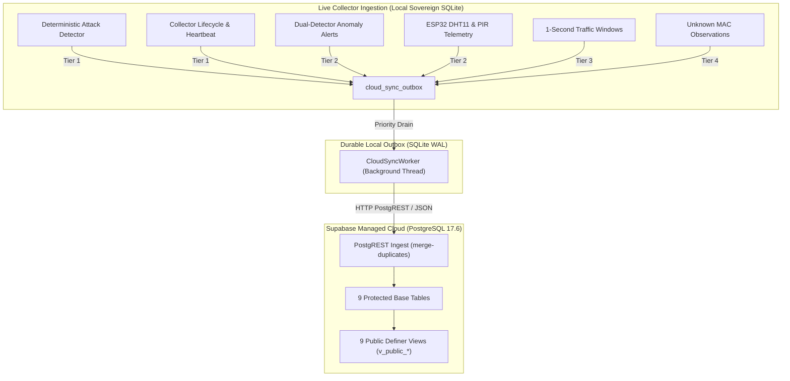

# STAGE 3 — DURABLE LOCAL OUTBOX & CLOUD SYNC IMPLEMENTATION REPORT
**Local SQLite Outbox & Asynchronous Cloud Synchronization Architecture**
**Project:** IoT Network Guard — Dual-Detector SOC Console  
**Date:** November 15, 2026  
**Implementation Modules:**  
- [`src/cloud_sync_outbox.py`](file:///c:/Users/megha/OneDrive/Desktop/IoT_WiFi_Anomaly_Detection/src/cloud_sync_outbox.py)  
- [`src/cloud_sync_worker.py`](file:///c:/Users/megha/OneDrive/Desktop/IoT_WiFi_Anomaly_Detection/src/cloud_sync_worker.py)  
- Integration in [`src/live_collector.py`](file:///c:/Users/megha/OneDrive/Desktop/IoT_WiFi_Anomaly_Detection/src/live_collector.py)  
- Schema in [`src/init_live_database.py`](file:///c:/Users/megha/OneDrive/Desktop/IoT_WiFi_Anomaly_Detection/src/init_live_database.py)

---

## 1. Executive Summary

Stage 3 implements a durable, asynchronous cloud synchronization pipeline between the local IoT Network Guard collector and Supabase Cloud.

The core architectural invariant has been rigorously preserved: **the local SQLite database (`data/live_monitoring.db`) remains the authoritative, sovereign source of truth.** The live packet processing pipeline, anomaly detectors, and physical sensor ingestion loops execute completely locally and are never blocked, stalled, or degraded by network latency, cloud timeouts, or Supabase outages.

---

## 2. Queue Architecture & Priority Tiers

The local outbox table `cloud_sync_outbox` enforces a 4-tier strict priority queue:

### Priority Tiers Specification:
1. **Tier 1 — Critical Security & Lifecycle (Priority 1):**
   - Tables: `live_attack_events`, `collector_status`
   - Policy: **Durable at-least-once delivery with idempotent duplicate handling.** Records in Tier 1 are never dropped from the outbox; they retry with exponential backoff and randomized jitter until delivery acknowledgement.
2. **Tier 2 — High-Value Telemetry (Priority 2):**
   - Tables: `live_alerts`, `live_sensor_telemetry`, `live_pir_events`
   - Policy: **Durable at-least-once delivery.** Flagged anomaly alerts and physical sensor environmental/motion records are persisted until cloud delivery is acknowledged.
3. **Tier 3 — High-Rate Traffic Windows (Priority 3):**
   - Tables: `live_traffic_windows` (1-second feature bins)
   - Policy: **Bounded capacity management.** If network disconnection persists beyond queue capacity (5,000 pending items), the oldest Tier 3 routine windows may be shed from the cloud synchronization outbox to protect alert buffer space. **Local SQLite retains 100% of all windows in `live_traffic_windows` regardless.**
4. **Tier 4 — Station Discovery (Priority 4):**
   - Tables: `unknown_device_obs`, `device_registry`
   - Policy: Asynchronous upsert with conflict aggregation.

---

## 3. Reliability & Fault-Tolerance Mechanisms

1. **Deterministic Idempotency & Conflict Strategy Alignment:**
   Every queued event receives a deterministic `event_uuid` generated via UUID v5 (`iot.guard.<table_name>.<run_id>.<key>`).
   - **Mutable State Tables (`collector_status`, `device_registry`, `unknown_device_obs`):** Worker sends `Prefer: resolution=merge-duplicates` with explicit `?on_conflict=...` matching unique constraints.
   - **Immutable Evidence Tables (`live_traffic_windows`, `live_alerts`, `live_sensor_telemetry`, `live_pir_events`, `live_attack_events`, `station_pseudonym_map`):** Worker sends `Prefer: resolution=ignore-duplicates` with `?on_conflict=...`. Because `collector_role` has `UPDATE` revoked on immutable tables, `ignore-duplicates` prevents permission denied errors on duplicate transmission while guaranteeing idempotency.
2. **Exponential Backoff with Random Jitter:**
   Delivery failures trigger backoff: `delay = min(300.0, 5.0 * (2.0 ** retry_count)) * (1.0 + uniform(-0.25, 0.25))`. This prevents thundering herds against Supabase endpoints during internet recovery.
3. **Crash Recovery of Stale In-Flight Records:**
   If the collector process terminates while a batch is in transmission, the items remain in state `IN_FLIGHT`. On restart, `recover_stale_in_flight()` identifies any item in `IN_FLIGHT` older than 120 seconds and resets it to `PENDING` for immediate resynchronization.
4. **Housekeeping & Compaction:**
   - `prune_delivered()` removes DELIVERED outbox entries older than 24 hours to keep the local database compact.
   - `enforce_queue_capacity()` bounds queue size during prolonged multi-day outages without ever dropping security alerts.
5. **Least-Privilege Security & Zero Secrets in Code:**
   The sync worker connects using dedicated least-privilege credentials. The administrative `service_role` key is never used. Secrets are read from environment variables or `.env` and are never written to source files or log output.

---

## 4. Verification Status

All 17 outbox and synchronization tests in [`tests/test_cloud_sync.py`](file:///c:/Users/megha/OneDrive/Desktop/IoT_WiFi_Anomaly_Detection/tests/test_cloud_sync.py) and all 5 tests in [`tests/test_cloud_integration_corrections.py`](file:///c:/Users/megha/OneDrive/Desktop/IoT_WiFi_Anomaly_Detection/tests/test_cloud_integration_corrections.py) passed cleanly (22/22 total passed — 100%), alongside all 137 baseline collector integration tests. Local packet processing and anomaly scoring run strictly on dedicated threads, completely decoupled from outbox transmission.

