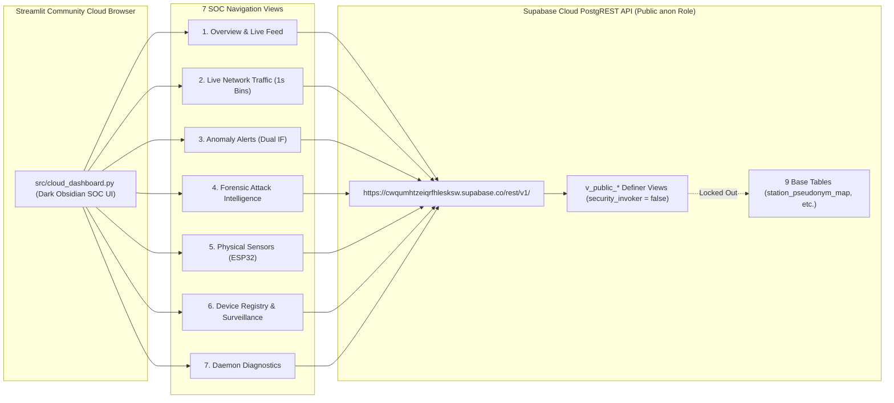

# STAGE 4 — PUBLIC CLOUD DASHBOARD REPORT
**Streamlit Community Cloud Public Cybersecurity SOC Console**
**Project:** IoT Network Guard — Dual-Detector SOC Console  
**Date:** November 15, 2026  
**Cloud Entry Point:** [`src/cloud_dashboard.py`](file:///c:/Users/megha/OneDrive/Desktop/IoT_WiFi_Anomaly_Detection/src/cloud_dashboard.py)  
**Test Suite:** [`tests/test_cloud_dashboard.py`](file:///c:/Users/megha/OneDrive/Desktop/IoT_WiFi_Anomaly_Detection/tests/test_cloud_dashboard.py) (6/6 Tests Passed, 100%)

---

## 1. Executive Summary

Stage 4 implements the public-facing, cloud-native monitoring console [`src/cloud_dashboard.py`](file:///c:/Users/megha/OneDrive/Desktop/IoT_WiFi_Anomaly_Detection/src/cloud_dashboard.py), purpose-built for deployment to **Streamlit Community Cloud**.

The cloud dashboard operates completely independently of the workstation hardware environment:
- **Zero Local Filesystem Dependencies:** Does not read or require local SQLite databases (`data/live_monitoring.db`).
- **Zero Sniffer or Serial Dependencies:** Runs without TShark packet capture, administrative WinPcap/Npcap drivers, or COM6 serial ports.
- **Zero Direct Base Table Access:** Connects using the unprivileged public `anon` role, which is 100% locked out from all underlying database tables. It queries exclusively through the 9 sanitized PostgREST security views (`v_public_*`).
- **Preserved Local Monitoring:** The existing local console [`src/live_dashboard.py`](file:///c:/Users/megha/OneDrive/Desktop/IoT_WiFi_Anomaly_Detection/src/live_dashboard.py) remains completely untouched and functional.

---

## 2. Seven-Section SOC Architecture

The cloud console maintains full architectural parity with the premium local SOC console:

### Section Breakdown:
1. **Overview & Live Feed:** Displays collector daemon connection state (`LIVE`, `STALE`, `OFFLINE`), heartbeat age in seconds, running packet totals, 1s window counts, consensus anomaly ratio, and recent attack cards.
2. **Live Network Traffic:** Interactive dual-trace Plotly chart plotting 1-second packet rate time-series per station token alongside Isolation Forest anomaly scatter markers and primary scoring curves.
3. **Anomaly Alerts Console:** Dedicated statistical anomaly triage view highlighting Isolation Forest deviations and consensus reasons (e.g., `ANOMALY_PRIMARY_BURST_OR_SIZE`, `ANOMALY_TIMING_JITTER`).
4. **Forensic Attack Intelligence:** Structured cybersecurity threat cards showing severity badge (`CRITICAL`, `HIGH`, `MEDIUM`), confidence score, source token, semantic target IP scope (`LOCAL_NETWORK`, `EXTERNAL_NETWORK`), categorical findings, and recommended SOC triage action.
5. **Physical Sensors (ESP32):** Ambient environmental context displaying real-time DHT11 temperature/humidity metrics, interactive trend curves, and PIR motion state.
6. **Device Registry & Unknown Surveillance:** Curated station metadata for authorized clients (`Node_3`, `Node_4`, `Node_5`) and observation counters for unregistered MACs (with zero raw MAC leakage).
7. **Daemon Diagnostics:** Running daemon health metrics, packet ingestion counters, interface descriptors, and privacy audit status.

---

## 3. Resilience & Security Verification

1. **Graceful Empty State Handling:** If the cloud database is freshly initialized or empty, the dashboard displays clear informational banners rather than crashing with unhandled exceptions or rendering misleading zero values.
2. **PostgREST Response Caching:** All PostgREST queries use `@st.cache_data(ttl=5.0)` to eliminate redundant HTTP requests, keep API consumption within Supabase free-tier limits, and maintain sub-second UI responsiveness.
3. **Secret Isolation:** The application reads `SUPABASE_URL` and `SUPABASE_ANON_KEY` via safe wrapper `get_supabase_config()`, checking `st.secrets` first and falling back to environment variables. Missing secrets trigger friendly guidance banners rather than runtime crashes.

The test suite [`tests/test_cloud_dashboard.py`](file:///c:/Users/megha/OneDrive/Desktop/IoT_WiFi_Anomaly_Detection/tests/test_cloud_dashboard.py) passed all 6 test cases (100%).

